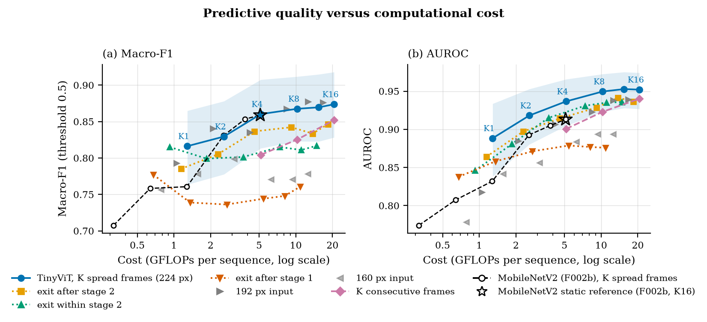
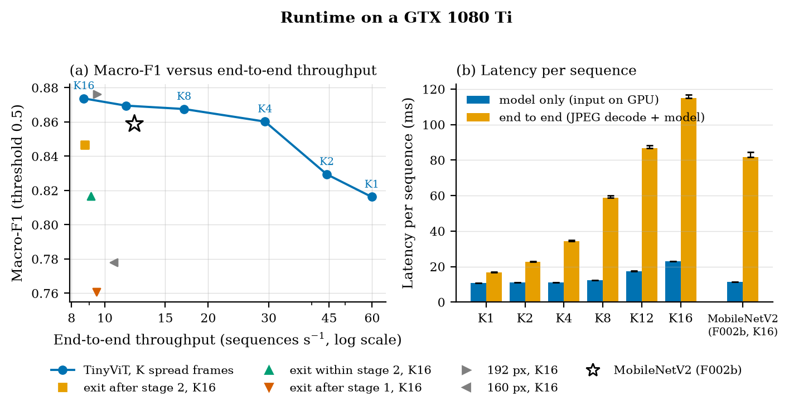
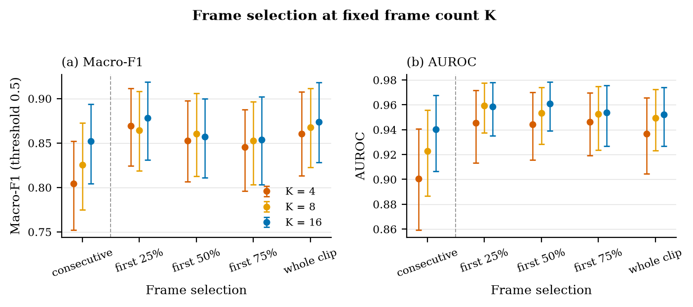
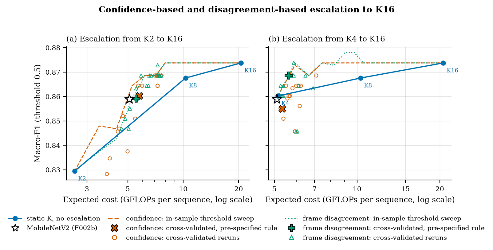
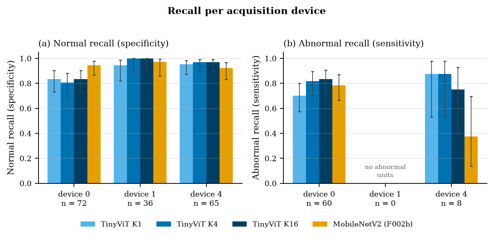

# F003 — Adaptive dimensions of the D026 TinyViT (T009)

**Question:** which ways of changing the compute of the frozen D026 TinyViT
checkpoint give useful accuracy–cost trade-offs for T010?

**Scope:** DAS-5, 2026-10-06, issue #11. T006 validation partition only, at the
duplicate-aware unit level (254 units, 76 abnormal; one unit ≈ 0.005 macro-F1).
No test-partition inference. One checkpoint, one seed. Not tested: model width
(no width switch without retraining) and compression interactions (T011).

## Summary

- **Frame count K is the axis to build on.** Cost is linear in K (1.29 GFLOPs
  per frame). K8 is practically equal to K16, K4 slightly lower, K1/K2 clearly
  lower (Tables 1 and 6). Threshold-free (AUROC), the K curve lies above every
  alternative tested (Figure 1b).
- **Spread frames beat consecutive frames at K4** (p = 0.04); weaker at K8, not
  detectable at K16. How much of the clip the spread covers shows no detectable
  effect (Table 3).
- **Input-driven escalation is unresolved.** In-sample it looked like K16
  quality at a third of the cost; cross-validated reruns scatter around plain K4,
  and only 7 units can be fixed from K4 (Table 4).
- **Rejected:** frozen-trunk early exits and lower resolution, both with lower
  AUROC than the K curve at similar cost (Table 2).
- **Versus MobileNetV2 (F002b):** run at the same nested K, its frame-count
  curve lies level with or below TinyViT's at every matched cost; the gap is
  largest at the cheap end, but no single matched comparison is resolved. At the static
  reference's own cost (TinyViT K4) macro-F1 ties with different errors on 39
  units; MobileNetV2 has higher device-0 normal recall (Tables 5–7).

## Figures

Made by `create_figures.py` from the saved results only (no model is run);
tracked as PDF and PNG in `figures/`. All panels: validation units as above,
macro-F1 at threshold 0.5, AUROC threshold-free, 95% unit-bootstrap intervals
(1,000 resamples, seed 2026) unless stated. Open star: MobileNetV2 F002b (K16).

**Figure 1.** Predictive quality against cost. (a) Macro-F1; (b) AUROC. Cost
is fvcore GFLOPs per sequence (F002 convention, log scale). Solid line: K = 1,
2, 4, 8, 12, 16 at 224 px with its 95% band. Dotted: linear exit heads on the
frozen trunk. Triangles: 192 and 160 px. Pink dashed: K consecutive frames.
Black dashed, open circles: MobileNetV2 F002b at the same nested K (its own
bilinear preprocessing). Other intervals are omitted for legibility (Tables 2,
6 and 7).


**Figure 2.** Runtime on one GTX 1080 Ti (node201, shared). (a) Macro-F1
against end-to-end throughput: completed sequences per second with JPEG decode,
preprocessing, transfer and inference run serially (median of 5 × 200
requests); exit and resolution variants timed at K16 only. (b) Median latency
for model-only (input on GPU, unfused attention) and end-to-end paths; whiskers
to the 95th percentile. MobileNetV2 re-timed in the same job; it resizes
bilinearly, TinyViT bicubically.


**Figure 3.** Frame selection at fixed K = 4, 8, 16 (final head, 224 px).
(a) Macro-F1; (b) AUROC; bars are 95% intervals. "Consecutive" is the first K
frames; the other categories spread K frames over the first 25/50/75/100% of
each clip. Shares are fractions of a clip; frame rate is unknown.


**Figure 4.** Escalation to K16 from (a) K2 and (b) K4. Units whose score
exceeds a threshold are re-scored at K16, reusing the cheap frames; expected
cost = cheap pass + escalated share of the remaining K16 work. Scores:
confidence (vermillion, dashed, circles) and frame disagreement (green, dotted,
triangles). Lines: in-sample threshold sweeps. Filled markers (× confidence,
+ disagreement): pre-specified cross-validated estimates. Open markers:
cross-validated reruns (Table 4).


**Figure 5.** Recall per acquisition device: (a) normal recall (specificity),
(b) abnormal recall (sensitivity). n = normal (a) or abnormal (b) units.
Wilson 95% intervals. Device 5 and mixed-device units (13 units) not shown
(Table 5).


## Method

All configurations use the hash-checked D026 checkpoint
(`checkpoints/f002c_tinyvit5m_epoch8.pt`), F002c bicubic full-square
preprocessing, threshold 0.5 and the T006 duplicate-aware units.

- **Frame count K ∈ {1, 2, 4, 8, 12, 16}.** K4/K8/K16 are the frozen F002
  sampler; K12 stops the same bisection at 12; K2 keeps the two interior
  thirds anchors, K1 the first. All sets are nested: K1 ⊂ K2 ⊂ … ⊂ K16
  (`adaptive.frame_indices`, tested against the frozen sampler for N = 16–399).
- **Frame selection.** `window{25,50,75,100}_k{4,8,16}` spreads K frames over
  the first max(16, ⌈share × N⌉) frames; `dense_k{4,8,16}` takes the first K
  consecutive frames. Cost equals the main configuration with the same K.
- **Exits.** Linear heads after stage 1 (128-d), after block 3 of stage 2
  (160-d) and after stage 2 (160-d), on spatially pooled features averaged over
  K: standardized L2 logistic regression (C = 1, no class weights,
  duplicate-aware sample weights) fitted on train-split K16 features of the
  frozen trunk, folded into one `nn.Linear`.
- **Resolution 160/192/224 px.** Same weights; TinyViT pads its attention
  windows.
- **MobileNetV2 at each K.** The frozen F002b checkpoint (read-only,
  hash-checked) with its own F002 bilinear preprocessing and the same nested
  frame sets, from one cached K16 pass. FLOPs use the F002 counter and handlers
  with only the K4/8/16 restriction lifted (identical at K4/8/16, tested).
- **One cached pass.** Features are mean-pooled per frame before a linear head
  and every K set lies inside K16, so one K16 pass storing per-frame features at
  every exit gives every (exit, K) prediction. The cache reproduces direct
  logits to 9.5e-7; the full-clip windows reproduce the main K4/K8/K16 results
  exactly.
- **Escalation.** Escalate a unit to K16 when its score exceeds a threshold.
  Scores: confidence −|p − 0.5| and frame disagreement (standard deviation of the
  cheap frames' per-frame probabilities, averaged over a unit's aliases).
  Expected FLOPs = cheap + escalation rate × (K16 − reused work). In-sample:
  thresholds swept on the scored units. Cross-validated: 5 folds by dependency
  group (seed 2026; 50/70/47/52/35 units); on 4 folds the pre-specified rule
  takes the cheapest threshold with macro-F1 ≥ that of K16 − 0.01, applied to
  the 5th. Reruns vary the fold seed (2026, 1–4) and tolerance (0, 0.005, 0.01,
  0.02).
- **Statistics.** Unit bootstrap (1,000 resamples for intervals, 2,000 for
  paired ΔAUROC); exact McNemar on correctness at 0.5.
- **Cost.** Strict fvcore with the F002 handlers (one multiply-add = one FLOP).
  Reviewed TinyViT bookkeeping: `view`, `split_with_sizes`, padding/contiguous
  copies and `index` (attention-bias gather) move data; `rsub`, `remainder` and
  `floor_divide` occur only as 0-d padding arithmetic and fail closed on real
  tensors.
- **Runtime.** F002 §9 protocol: first 200 validation rows, 50 warm-up requests
  before each of 5 repeats, model-only and JPEG-pipeline paths.

## Commands

From the repository root on DAS-5 (`myenv`, CUDA 12.6 module):

```bash
sbatch experiments/F003/das5_f003.sbatch flops
sbatch experiments/F003/das5_f003.sbatch features --partition train
sbatch experiments/F003/das5_f003.sbatch features --partition validation
sbatch experiments/F003/das5_f003.sbatch features --partition validation --resolution 160
sbatch experiments/F003/das5_f003.sbatch features --partition validation --resolution 192
sbatch experiments/F003/das5_f003.sbatch analyze
sbatch -w node201 experiments/F003/das5_f003.sbatch benchmark-reference
sbatch -w node201 experiments/F003/das5_f003.sbatch benchmark
sbatch experiments/F003/das5_f003.sbatch features-temporal
sbatch experiments/F003/das5_f003.sbatch analyze-extra
sbatch --gres=gpu:0 experiments/F003/das5_f003.sbatch analyze-robustness   # CPU only
sbatch experiments/F003/das5_f003.sbatch mobilenet-k
python experiments/F003/run_f003.py report       # summary.json
python experiments/F003/create_figures.py        # needs matplotlib
```

Tests: `python -m unittest tests.test_f003`. `features` refuses to overwrite
cached features and `benchmark` skips finished configurations, so reruns cannot
mix passes or timing sessions.

## Provenance

- Python 3.12.14, torch 2.14.0+cu126, timm 1.0.30, fvcore 0.1.5.post20221221.
  Every artifact records host, GPU, versions and source hashes.
- Feature passes ran on whatever GPU SLURM assigned (no model constraint, per
  the teaching-team advice recorded for F002c), FP32 with TF32 off: train 224 px
  on node219 (Titan RTX, 62 s), validation 224 px on node202 (GTX TITAN X, 22 s),
  160/192 px on node220 (Titan RTX, 13–14 s), temporal frames on a GTX 1080 Ti
  (12,468 frames, 46 s), MobileNetV2 frames on node205 (GTX 1080 Ti, 27 s; cache
  reproduces direct logits to 3.8e-6 and F002b's recorded K16 macro-F1 exactly).
- All timings ran in job 110931 on node201 (GTX 1080 Ti, driver 580.95.05), the
  F002b timing host, shared with another user's 7-day jobs. The same job re-timed
  F002b read-only: 11.33 ms model-only (11.40 ms in the exclusive F002b run),
  81.8 ms end-to-end (then 89.2 ms).
- Code grew during the run, so earlier artifacts record earlier source hashes:
  `run_f003.py` gained later commands, and `adaptive.py` gained the frame-selection
  helpers, with the existing preprocessing moved unchanged into `load_frame`.
  Functions used by earlier artifacts did not change; the reproduction checks
  above confirm it.

## Results

**Table 1. Frame count (224 px, final head).** Latency: median of 5 repeat
medians; model-only uses unfused attention.

| K | Macro-F1 [95% CI] | AUROC | Acc. | Normal rec. | Abnormal rec. | GFLOPs | Model-only ms | End-to-end ms | End-to-end seq/s |
|---:|---|---:|---:|---:|---:|---:|---:|---:|---:|
| 1 | 0.816 [0.764, 0.865] | 0.888 | 0.846 | 0.893 | 0.737 | 1.29 | 10.72 | 16.7 | 59.8 |
| 2 | 0.830 [0.778, 0.878] | 0.918 | 0.854 | 0.882 | 0.789 | 2.57 | 10.99 | 22.6 | 44.3 |
| 4 | 0.860 [0.813, 0.907] | 0.937 | 0.882 | 0.910 | 0.816 | 5.15 | 10.99 | 34.2 | 29.2 |
| 8 | 0.868 [0.823, 0.912] | 0.950 | 0.890 | 0.927 | 0.803 | 10.30 | 12.20 | 58.8 | 17.0 |
| 12 | 0.870 [0.823, 0.915] | 0.953 | 0.890 | 0.916 | 0.829 | 15.45 | 17.47 | 86.8 | 11.5 |
| 16 | 0.874 [0.828, 0.918] | 0.952 | 0.894 | 0.921 | 0.829 | 20.60 | 22.93 | 115.1 | 8.7 |
| MobileNetV2 F002b, K16 | 0.859 | 0.913 | 0.886 | 0.944 | 0.750 | 5.11 | 11.33 | 81.8 | 12.2 |

K16 reproduces F002c's recorded result. Fused attention is 0.2–1.8 ms faster
model-only, but its logits differ from unfused by 0.5e-5 to 2.2e-5, around the
1e-5 limit borrowed from D024; end-to-end timings used fused attention where it
passed (K8, K12, K16, 160/192 px, mid-stage-2 exit), which moves them by about
1 ms.

**Table 2. Exits and resolution.**

| Configuration | K | Macro-F1 | AUROC | Normal rec. | Abnormal rec. | GFLOPs | Model-only ms |
|---|---:|---:|---:|---:|---:|---:|---:|
| Exit after stage 1 | 1 / 4 / 16 | 0.777 / 0.736 / 0.761 | 0.838 / 0.871 / 0.876 | 0.927 / 0.933 / 0.921 | 0.592 / 0.500 / 0.566 | 0.68 / 2.71 / 10.85 | – / – / 13.83 |
| Exit within stage 2 | 1 / 4 / 16 | 0.815 / 0.801 / 0.817 | 0.846 / 0.915 / 0.936 | 0.938 / 0.944 / 0.933 | 0.658 / 0.618 / 0.671 | 0.92 / 3.69 / 14.78 | – / – / 17.72 |
| Exit after stage 2 | 1 / 4 / 16 | 0.785 / 0.837 / 0.846 | 0.864 / 0.914 / 0.937 | 0.921 / 0.944 / 0.949 | 0.618 / 0.697 / 0.711 | 1.15 / 4.59 / 18.35 | – / – / 21.31 |
| 192 px | 2 / 4 / 8 / 16 | 0.841 / 0.835 / 0.867 / 0.876 | 0.885 / 0.906 / 0.923 / 0.939 | 0.972 / 0.949 / 0.955 / 0.966 | 0.658 / 0.684 / 0.750 / 0.750 | 2.09 / 4.18 / 8.35 / 16.71 | – / – / – / 18.89 |
| 160 px | 8 / 16 | 0.771 / 0.778 | 0.883 / 0.894 | 1.000 / 1.000 | 0.474 / 0.487 | 6.27 / 12.54 | – / 14.27 |

All 36 configurations are in `analysis.json`. End-to-end latency of
the K16 exits is 105–114 ms.

**Table 3. Frame selection (final head, 224 px).** Δ = paired macro-F1
difference to whole-clip K16.

| Frames | Macro-F1 [95% CI] | AUROC | Normal rec. | Abnormal rec. | Δ [95% CI] |
|---|---|---:|---:|---:|---|
| K4, consecutive | 0.804 [0.752, 0.852] | 0.901 | 0.876 | 0.737 | −0.069 [−0.120, −0.021] |
| K4, first 25% | 0.870 [0.824, 0.912] | 0.945 | 0.916 | 0.829 | −0.004 [−0.043, +0.034] |
| K4, first 50% | 0.853 [0.807, 0.897] | 0.944 | 0.921 | 0.776 | −0.021 [−0.053, +0.006] |
| K4, first 75% | 0.846 [0.796, 0.888] | 0.946 | 0.904 | 0.789 | −0.028 [−0.069, +0.006] |
| K4, whole clip | 0.860 [0.813, 0.907] | 0.937 | 0.910 | 0.816 | −0.014 [−0.045, +0.015] |
| K8, consecutive | 0.826 [0.775, 0.873] | 0.923 | 0.876 | 0.789 | −0.048 [−0.098, −0.001] |
| K8, first 25% | 0.864 [0.819, 0.908] | 0.959 | 0.916 | 0.816 | −0.009 [−0.054, +0.033] |
| K8, first 50% | 0.860 [0.813, 0.906] | 0.953 | 0.910 | 0.816 | −0.014 [−0.045, +0.015] |
| K8, first 75% | 0.853 [0.803, 0.897] | 0.953 | 0.921 | 0.776 | −0.021 [−0.052, +0.007] |
| K8, whole clip | 0.868 [0.823, 0.912] | 0.950 | 0.927 | 0.803 | −0.006 [−0.030, +0.014] |
| K16, consecutive | 0.852 [0.804, 0.894] | 0.940 | 0.899 | 0.816 | −0.022 [−0.073, +0.025] |
| K16, first 25% | 0.878 [0.831, 0.919] | 0.959 | 0.927 | 0.829 | +0.004 [−0.041, +0.048] |
| K16, first 50% | 0.857 [0.811, 0.900] | 0.961 | 0.899 | 0.829 | −0.017 [−0.052, +0.015] |
| K16, first 75% | 0.854 [0.803, 0.902] | 0.954 | 0.916 | 0.789 | −0.020 [−0.050, +0.009] |
| K16, whole clip | 0.874 [0.828, 0.918] | 0.952 | 0.921 | 0.829 | 0 |

Every window starts at frame 0; later windows are not tested.

**Table 4. Escalation to K16.** Pre-specified CV = fold seed 2026, tolerance
0.01; reruns = 5 fold seeds × 4 tolerances. Ceiling = units wrong at the cheap
K and right at K16 (right at the cheap K and wrong at K16).

| From | Signal | In-sample example | Pre-specified CV: macro-F1, escalated, GFLOPs | CV reruns: min–max (mean) | Ceiling |
|---|---|---|---|---|---|
| K1 | confidence | 0.846 at 3.34 GFLOPs (11%) | 0.851, 33.5%, 7.75 | – | – |
| K2 | confidence | 0.864 at 5.34 GFLOPs (15%) | 0.860, 17.7%, 5.77 | 0.828–0.869 (0.858) | 14 (4) |
| K2 | disagreement | – | 0.859, 16.5%, 5.55 | 0.847–0.873 (0.862) | 14 (4) |
| K4 | confidence | 0.874 at 6.85 GFLOPs (11%) | 0.855, 1.2%, 5.33 | 0.846–0.869 (0.859) | 7 (4) |
| K4 | disagreement | 0.874 at 5% escalation | 0.869, 3.1%, 5.64 | 0.846–0.874 (0.863) | 7 (4) |
| K8 | confidence | 0.874 at 12.3 GFLOPs (20%) | 0.863, 2.0%, 10.50 | – | – |
| K8 | disagreement | – | 0.863, 6.3%, 10.95 | – | – |

For reference, static K2 0.830 (2.57 GFLOPs), K4 0.860 (5.15), K8 0.868
(10.30). K2 reruns cost 3.9–7.6 GFLOPs (median 6.0). The pre-specified K4
confidence rule escalates almost nothing because K4 is within 0.01 of K16 on
most training folds. In-sample exit cascades: from stage 1, 0.886 at 45%
escalation (15.3 GFLOPs). Full curves: `analysis.json`, `analysis_extra.json`.

**Table 5. Per device** (accuracy / normal recall / abnormal recall).

| Device (units, abnormal) | TinyViT K1 | TinyViT K4 | TinyViT K16 | MobileNetV2 F002b |
|---|---|---|---|---|
| 0 (132, 60) | 0.773 / 0.833 / 0.700 | 0.811 / 0.806 / 0.817 | 0.833 / 0.833 / 0.833 | 0.871 / 0.944 / 0.783 |
| 1 (36, 0) | 0.944 / 0.944 / – | 1.000 / 1.000 / – | 1.000 / 1.000 / – | 0.972 / 0.972 / – |
| 4 (73, 8) | 0.945 / 0.954 / 0.875 | 0.959 / 0.969 / 0.875 | 0.945 / 0.969 / 0.750 | 0.863 / 0.923 / 0.375 |
| 5 (5, 4) | 0.800 / 1.000 / 0.750 | 0.800 / 1.000 / 0.750 | 0.800 / 1.000 / 0.750 | 1.000 / 1.000 / 1.000 |
| mixed (8, 4) | 0.750 / 0.500 / 1.000 | 0.875 / 1.000 / 0.750 | 1.000 / 1.000 / 1.000 | 0.875 / 1.000 / 0.750 |

**Table 6. Paired comparisons** (same units). ΔF1 = paired macro-F1
difference; McNemar = units only A / only B gets right at 0.5.

| A − B | ΔF1 [95% CI] | ΔAUROC [95% CI] | McNemar (p) |
|---|---|---|---|
| K1 − K16 | −0.057 [−0.107, −0.012] | −0.064 [−0.107, −0.027] | 8 / 20 (0.04) |
| K2 − K16 | −0.044 [−0.083, −0.008] | −0.034 [−0.061, −0.012] | 4 / 14 (0.03) |
| K4 − K16 | −0.014 [−0.045, +0.015] | −0.015 [−0.034, −0.001] | 4 / 7 (0.55) |
| K8 − K16 | −0.006 [−0.030, +0.014] | −0.002 [−0.012, +0.006] | 2 / 3 (1.00) |
| K12 − K16 | −0.004 [−0.023, +0.011] | – | – |
| TinyViT K4 − F002b | +0.001 [−0.057, +0.064] | +0.024 [−0.020, +0.066] | 19 / 20 (1.00) |
| TinyViT K8 − F002b | +0.009 [−0.049, +0.077] | – | – |
| TinyViT K16 − F002b | +0.015 [−0.040, +0.077] | +0.039 [+0.003, +0.079] | 19 / 17 (0.87) |
| 192 − 224 px, K2 / K8 / K16 | – | −0.033 / −0.027 / −0.013 (CIs include 0) | 18/12, 12/11, 12/10 (≥ 0.36) |
| Exit within stage 2 − full, K1 | – | −0.042 [−0.084, −0.002] | 14 / 12 (0.85) |
| Exit after stage 2 − full, K4 | – | −0.022 [−0.058, +0.010] | 9 / 12 (0.66) |
| First 25% − whole clip, K4 | – | +0.009 [−0.008, +0.024] | 12 / 10 (0.83) |
| Consecutive − spread, K4 / K8 / K16 | – | −0.036 [−0.071, −0.003] / −0.027 [−0.060, +0.004] / −0.012 [−0.039, +0.013] | 8/20 (0.04), 10/20 (0.10), 12/17 (0.46) |
| TinyViT K4 − F002b, device 0 normal / abnormal | – | – | 1/11 (0.006), 8/6 (0.79) |
| TinyViT K4 − F002b, device 4 normal / abnormal | – | – | 4/1 (0.38), 4/0 (0.13) |
| TinyViT K1 − MobileNetV2 K4 (1.29 vs 1.28 GFLOPs) | +0.056 [−0.017, +0.128] | +0.056 [−0.012, +0.122] | 31 / 23 (0.34) |
| TinyViT K2 − MobileNetV2 K8 (2.57 vs 2.55 GFLOPs) | −0.001 [−0.066, +0.066] | +0.026 [−0.021, +0.075] | 23 / 26 (0.78) |

**Table 7. MobileNetV2 F002b at each K** (frozen K16 checkpoint, no
retraining). Last column: paired TinyViT − MobileNetV2 at the same K.

| K | GFLOPs | Macro-F1 [95% CI] | AUROC [95% CI] | Acc. | Normal rec. | Abnormal rec. | ΔAUROC same K [95% CI] |
|---:|---:|---|---|---:|---:|---:|---|
| 1 | 0.32 | 0.708 [0.644, 0.765] | 0.774 [0.711, 0.833] | 0.780 | 0.910 | 0.474 | +0.114 [+0.050, +0.178] |
| 2 | 0.64 | 0.758 [0.695, 0.817] | 0.807 [0.749, 0.867] | 0.815 | 0.927 | 0.553 | +0.111 [+0.055, +0.168] |
| 4 | 1.28 | 0.761 [0.698, 0.820] | 0.832 [0.773, 0.887] | 0.815 | 0.921 | 0.566 | +0.105 [+0.053, +0.158] |
| 8 | 2.55 | 0.831 [0.774, 0.883] | 0.893 [0.848, 0.931] | 0.866 | 0.944 | 0.684 | +0.057 [+0.018, +0.099] |
| 12 | 3.83 | 0.853 [0.800, 0.900] | 0.905 [0.859, 0.942] | 0.882 | 0.944 | 0.737 | +0.048 [+0.008, +0.090] |
| 16 | 5.11 | 0.859 [0.806, 0.906] | 0.913 [0.870, 0.948] | 0.886 | 0.944 | 0.750 | +0.039 [+0.003, +0.079] |

The seed-42 F002a MobileNetV2 scored higher at small K (macro-F1 0.813 at K4,
0.858 at K8), so the frame-count response varies between checkpoints of the
same architecture.

## Interpretation

- **Frame count is the right axis (fairly confident).** Small, smooth quality
  loss for large cost cuts, no new weights, and above every alternative
  threshold-free; the trend holds within device 0. K8 halves K16's cost at no
  measurable loss; K4 loses a little; K1/K2 clearly more.
- **Spread, not consecutive, frames (moderate at K4, weak beyond).**
  Neighbouring frames overlap in content. The scan-share result is a null
  result: small differences are invisible here, and 15 windows on the same
  units invite chance patterns.
- **Escalation is unresolved, not refuted.** With 7 fixable units this set
  cannot separate a small gain from noise. T012 would need a rule fixed in
  advance and more data; budget-driven switching between fixed K needs no such
  tuning, hence D027's core policy.
- **Frozen exits fail** because the trunk was never trained for them, and
  stage 1 already costs 53% of a frame. Trained exits mean new weights.
- **Lower resolution ranks cases worse** (AUROC); 192 px's higher macro-F1 at
  some K reflects a shifted operating point. (An earlier draft argued from
  abnormal recall, a secondary metric.)
- **TinyViT versus MobileNetV2:** per FLOP, TinyViT's frame-count curve is
  level with or above MobileNetV2's everywhere they overlap, most clearly at the
  cheap end, where MobileNetV2 loses abnormal recall. No single matched
  comparison is resolved, and MobileNetV2's low-K response differs between
  checkpoints (F002a vs F002b), so this is a consistent tendency, not a proven
  gap. At threshold 0.5 part of the difference is calibration (MobileNetV2
  calls more units normal); D024 fixes 0.5 for the baseline.
- **Weight sharing holds by construction.** All K run the same weights, which
  satisfies "one deployable artifact" but leaves nothing to verify by comparing
  layers. The nested frame sets do allow anytime inference: moving from K4 to
  K16 reuses the four frames already computed. A stronger shared-weight
  mechanism (trained exits on a shared trunk, or training across K) changes the
  weights and should be decided before T010.
- **Runtime is setup-specific.** Model-only latency is flat for small K on the
  1080 Ti; end-to-end gains come from serial JPEG decoding, which a probe-fed
  device would not do; preprocessing differs between the models. FLOPs remain
  the comparable cost.
- **Limits:** one checkpoint and seed, validation also used to select the
  checkpoint, unknown frame rate, shared timing node, 76 abnormal units.

## Passed to T010

| Point | GFLOPs | Macro-F1 | AUROC | End-to-end ms | Note |
|---|---:|---:|---:|---:|---|
| K1 | 1.29 | 0.816 | 0.888 | 16.7 | lowest budget, clearly weaker |
| K2 | 2.57 | 0.830 | 0.918 | 22.6 | optional |
| K4 | 5.15 | 0.860 | 0.937 | 34.2 | same FLOPs as the static baseline |
| K8 | 10.30 | 0.868 | 0.950 | 58.8 | about as good as K16 |
| K16 | 20.60 | 0.874 | 0.952 | 115.1 | full |

One checkpoint, nested spread frames. MobileNetV2 F002b at the same K (Table 7)
is available as an adaptive comparison for T013. Not carried forward: exits,
lower resolution, consecutive frames. Escalation is an open T012 question; the
short-scan idea is untested rather than supported. Better cheap points would
most directly come from training across several K, which changes the weights
and needs its own decision.

## Artifacts

Ignored, in `artifacts/F003/` (local and DAS-5
`/var/scratch/bde2621/amea/artifacts/F003/`):

- `flops.json`: all 36 configurations with by-operator counts.
- `features/`: cached per-frame features (exits, nested positions, direct K16
  logits) and `validation_temporal.pt`.
- `exit_heads.pt`.
- `analysis.json`: metrics, intervals, paired macro-F1, in-sample cascades.
- `analysis_extra.json`: frame selection, cross-validated cascades with per-fold
  thresholds, per-device tables.
- `analysis_robustness.json`: AUROC with intervals, paired tests, escalation
  ceilings, rerun spread.
- `predictions/`: row CSVs and unit JSONs per configuration.
- `benchmark/`: raw per-request latencies, both attention paths, equivalence,
  F002b reference.
- `mobilenet_k/`: MobileNetV2 F002b at each K (`mobilenet_k.json`, predictions).
- `summary.json`, `figures/`, `logs/`; `pareto_f003.png` is an older overview
  plot, superseded by the figures.
