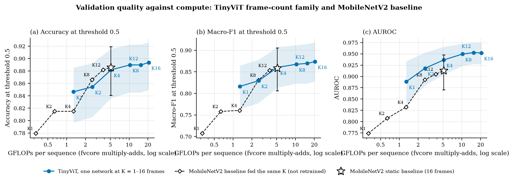
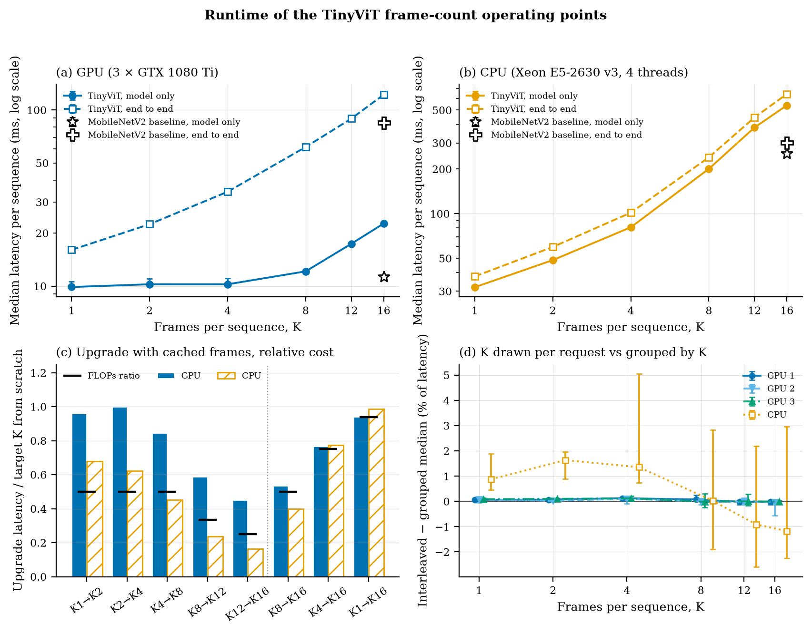
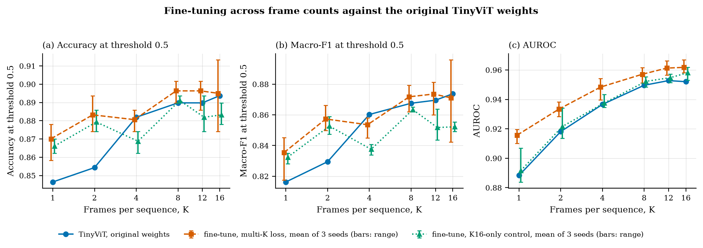
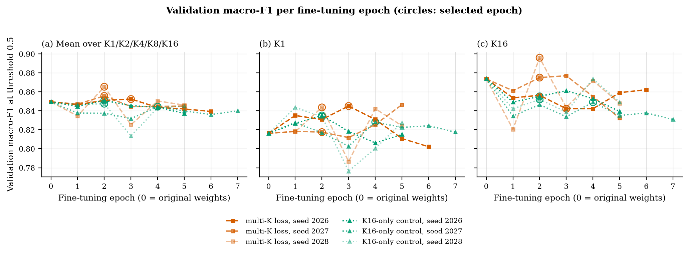

# F004 — Shared-weight frame-count operating points (T010)

**Question:** can the D027 frame-count axis be served as one deployable model
with at least three operating points that share weights, switch at runtime and
are measured under one cost convention? And does fine-tuning the weights across
K (F004b) give better operating points than the frozen D026 checkpoint?

**Scope:** DAS-5, 2026-10-07, issue #12. T006 validation partition only, at
the duplicate-aware unit level (254 units, 76 abnormal; one unit ≈ 0.005
macro-F1). No test-partition inference. Every quality number below comes from
the same validation units that selected the D026 checkpoint (F002c), the frame
count axis (F003) and the F004b epochs, so all of them are optimistic for
unseen data; the T006 test partition is reserved for T013.

## Summary

- **Six operating points: K = 1, 2, 4, 8, 12, 16 frames** on the unchanged D026
  TinyViT checkpoint, 1.29 to 20.60 GFLOPs (16×). Macro-F1 0.816 / 0.829 /
  0.860 / 0.868 / 0.870 / 0.874; accuracy 0.846 / 0.854 / 0.882 / 0.890 /
  0.890 / 0.894 (Table 1). K12 was added after review because 15.45 GFLOPs is
  0.75 × K16, which may matter for T012's budget states.
- **Input adaptation with temporal reuse.** In lecture 4's terms, K adapts the
  input's temporal window (approach family 4, p. 19) and reuses cached frame
  features (family 8, p. 23), which makes the family usable as anytime
  inference (p. 25). The frame sets are nested, K1 ⊂ K2 ⊂ … ⊂ K16,
  and every point uses the same trunk and head. A K16 run therefore contains
  the computation of every smaller point, and `AnytimeClip` continues a clip
  from a smaller K by encoding only the added frames: K4 → K16 costs 15.45
  instead of 20.60 GFLOPs. Moving down encodes nothing.
- **One artifact.** `AdaptiveTinyViT` (`family.py`) holds the 5,072,085
  parameters of the 20.4 MB D026 checkpoint and nothing else. A forward at each
  K reads all 215 parameter tensors, each equal to the checkpoint file
  (Table 2). A bag of six separately stored models of this size (lecture 4,
  p. 3–5) would take 123 MB. The family also exports
  to one ONNX graph with a variable frame axis that matches PyTorch to 4e-6 at
  every K and runs 15–33% faster in ONNX Runtime on CPU (Table 7).
- **Runtime switching.** On three GTX 1080 Ti hosts, changing K on 825 of
  1,000 requests moved per-K median latency by at most 0.13 ms (0.6% of that
  K's latency) against the same requests grouped by K. The first request at a
  new frame count after start-up is slow, up to about 150 ms at K16, because
  cuDNN tunes kernels per input shape; a deployment should run every K once at
  start-up (Table 4).
- **Latency follows FLOPs on CPU but not on this GPU.** GPU model-only latency
  is flat from K1 to K4 (about 10.2 ms) and 22.7 ms at K16. On one CPU node (4 threads) model-only latency rises with K: 32 / 49 / 81 / 201 / 381 / 538 ms, and anytime upgrades save time in proportion to the frames they skip (K4 → K16: 416 instead of 538 ms).
- **Against the static baseline.** At the baseline's own cost (5.1 GFLOPs),
  TinyViT K4 and MobileNetV2 F002b K16 tie on macro-F1 (0.860 vs 0.859) and
  nearly tie on accuracy (0.882 vs 0.886); TinyViT ranks cases better (AUROC
  0.937 vs 0.913) and finds more abnormal units (recall 0.816 vs 0.750), while
  MobileNetV2 keeps more normals (0.944 vs 0.910). Below that cost TinyViT
  scores higher (K1 vs MobileNetV2 at 4 frames, about 1.3 GFLOPs: macro-F1
  0.816 vs 0.761), but that difference is not resolved (31 / 23 discordant
  units, p = 0.34; F003); above 5 GFLOPs only TinyViT has points (Figure 1).
- **F004b: fine-tuning across K is not adopted.** The rule fixed before running
  (seed 2026) failed: mean macro-F1 over the five trained K rose 0.003 over
  D026, and K16 fell 0.874 → 0.842. Over three seeds the multi-K loss averages
  +0.008 over D026 (also below the 0.01 bar) and +0.010 over a K16-only
  control, with gains at K1/K2 and K16 ranging 0.842–0.896 between seeds
  (Table 5). The family keeps D026.

## Figures

Made by `create_figures.py` from the saved results only (no model is run);
tracked as PDF and PNG in `figures/`. Validation units as above.

**Figure 1.** Validation quality against cost. (a) Accuracy and (b) macro-F1 at
threshold 0.5; (c) AUROC. Cost is fvcore GFLOPs per sequence (F002
convention, log scale). Solid line: the family on D026 weights; band: 95%
interval (accuracy: Wilson; macro-F1 and AUROC: unit bootstrap, 1,000
resamples, seed 2026). Dashed diamonds: the frozen MobileNetV2 F002b
checkpoint at the same nested K (F003 Table 7), not retrained. Star with 95%
interval: MobileNetV2 F002b as the static baseline (16 frames, 5.11 GFLOPs).


**Figure 2.** Runtime, FP32, unfused attention. (a) GPU, three GTX 1080 Ti
hosts allocated exclusively: median of the hosts' median latency per
sequence, bars to the slowest and fastest host; model only (inputs on the
device) and end to end (JPEG decode, preprocessing, transfer and inference run
serially). Star and cross: MobileNetV2 F002b K16 timed in the same jobs. (b) The
same on one CPU node, 4 threads. (c) Model-only latency of an upgrade from
cached features divided by the latency of the target K from scratch (bars),
and the FLOPs ratio (black ticks); left of the dotted line one-step upgrades,
right of it larger jumps. (d) Interleaved minus grouped per-K median latency
when K is drawn at random per request, in percent of that K's latency; points:
median over 5 repeats, bars: range.


**Figure 3.** F004b per K. (a) Accuracy, (b) macro-F1 at 0.5, (c) AUROC of
the D026 weights and of the two fine-tunes at their selected epochs; markers:
mean of seeds 2026–2028, bars: range over seeds.


**Figure 4.** F004b validation macro-F1 per epoch for every run: (a) mean over
the five trained K, (b) K1, (c) K16. Epoch 0 is the D026 checkpoint; circles
mark the selected epoch.


## Where this differs from the lecture material

Slide numbers are PDF pages of the course slides in the vault (L2 pruning, L4
adaptive inference). Rows marked "follows" are listed where a reader might
expect a deviation.

| Lecture suggestion | What F004 does | Why, and the evidence |
|---|---|---|
| Choose early exit when input difficulty varies, slimmable when budgets vary (L4 p. 52) | Neither for T010: the knob is the input's temporal window (approach family 4, L4 p. 19) with reuse of cached frame features (family 8, p. 23); widths come in T011 | F003 found frame count the strongest axis; frozen-trunk exits lost AUROC against the K curve at equal cost |
| Early exits need trained exit heads with auxiliary losses (L4 p. 40) | No exit heads; F003's exits were linear heads on a frozen trunk | Training exits changes the weights; the frame axis gave a 16× range without new weights |
| The policy signal is often confidence, which must be calibrated (L4 p. 29, p. 33) | The intended policy is budget-driven (T012); confidence- and disagreement-driven escalation was tested in F003 | Cross-validated escalation scattered around plain K4 with only 7 fixable units; unresolved, not adopted |
| Anytime and budgeted inference (L4 p. 25) | Follows: both. A clip can continue to a larger K (anytime); a budget picks K (budgeted) | — |
| Delta switching: only parameter deltas are loaded or unloaded (L4 p. 66) | Nothing is loaded at all: one resident model, K only changes the input | Warm switching ≤ 0.13 ms; the first request at a new K pays about 150 ms of cuDNN tuning, removed by a start-up warm-up |
| Evaluate on the deployment hardware (L2 p. 53) | Desktop GPU (GTX 1080 Ti) and a server CPU (Xeon E5-2630 v3); no edge device | The brief accepts simulated scenarios; the CPU is the closer stand-in and is named as the target class |
| Report energy, and tail latency and subgroups rather than averages (L4 p. 30, p. 34; L2 p. 59) | Tail latency (p95/p99) and per-device results follow; energy is not measured | No power measurement on the DAS-5 nodes used; FLOPs and latency are the proxies |
| Fine-tune so all operating points stay accurate (L4 p. 31) | Not adopted: the multi-K fine-tune (F004b) failed its pre-specified rule | The unchanged weights already hold up at low K; the 3-seed hint of a low-K gain is unresolved |
| FLOPs ≈ 2 × MACs (L2 p. 56) | "GFLOPs" throughout are fvcore counts with one multiply-add = one FLOP, i.e. GMACs | One convention for every point and baseline, as the brief requires; double the numbers for the 2 × MAC convention |
| Brief tip: train on DAS-6 | DAS-5 | The course labs and our account run on DAS-5 |

## Method

**Family (F004a).** `AdaptiveTinyViT` wraps the encoder and binary head of one
F002c `TinyViTSequence`: encode each frame, average the 320-d features over K,
apply the head. It is F002c's computation with the K restriction widened to
the six points; outputs are bit-identical to F002c at K4/K8/K16 and to F003's
final-exit model at every K (tests). Frames come from F003's nested sampler
(`frame_indices`).

- **Anytime clip.** `AnytimeClip` caches each encoded frame's feature. A request
  at K encodes only the frames of K's set that are not cached, then pools the K
  cached features. FLOPs of such a move are counted on `Upgrade`, the same
  module with the cached features as a buffer and only the new frames as input.
- **Weight-sharing check.** `read_parameters` hooks every module with
  parameters and records which tensors a forward at K reads. The checks that
  can fail: every parameter is read at every K, and every parameter and BN
  buffer equals the checkpoint file. That all K use the same storage follows
  from there being one module; it is recorded, not tested.
- **Validation.** `evaluate` runs every validation row through the module at
  each K, then through one `AnytimeClip` rising K1 → K16 and falling back, and
  compares the logits with F003's saved predictions.
- **Cost.** Strict fvcore with F003's handlers and reviewed TinyViT
  bookkeeping (one multiply-add = one FLOP).
- **Runtime.** One job per host. Each request selects its K frames from
  preloaded K16 inputs inside the timed region (points, upgrades and
  switching alike). All configurations are timed round-robin: each of 5
  repeats times every configuration once (warm-up, then timed requests), in an
  order rotated by one per repeat, so drift during the job reaches all
  configurations alike. The first request of each configuration in the first
  round is timed before its warm-up (cold start). GPU: the first 200 F002 §9
  validation requests, 50 warm-up. CPU: the first 100, 10 warm-up, 4 threads.
  Switching: 1,000 (CPU 300) requests with K drawn at random (seed 2026), timed
  interleaved and grouped by K, the two orders alternating across 5 repeats.
  MobileNetV2 F002b K16 is re-timed read-only in the same job.

**Multi-K fine-tune (F004b).** Fixed before the first run and recorded in each
`run.json` at job start: start from D026; train split only; F002c recipe
(AdamW, flip augmentation, frozen BN statistics, duplicate-aware weights,
effective batch 8, clip 1.0) at half its peak learning rates (2.5e-5 encoder,
2.5e-4 head), one warm-up epoch, cosine over at most 10 epochs, patience 3
after epoch 3. Each train row's K16 frames are encoded once; each K's logit
comes from its nested subset.

- `multik` loss: mean BCE over K ∈ {1, 2, 4, 8, 16} (K12 joined the family
  later and is evaluated, not trained).
- `k16` control: BCE at K16 only, otherwise identical, including data order and
  flips, to separate the multi-K loss from extra training.
- Selection: validation macro-F1 at 0.5 averaged over the five trained K, then
  lower mean BCE, then earlier epoch; epoch 0 not selectable.
- Adoption rule, applied to seed 2026: propose the multi-K weights only if
  their mean macro-F1 beats both D026 and the control by ≥ 0.01 and K16 loses
  ≤ 0.01. Adoption would still need a team decision.
- Seeds 2027 and 2028 were added after review, to show how much the result
  moves between seeds; they do not change the rule.

## Commands

From the repository root on DAS-5 (`myenv`, CUDA 12.6 module):

```bash
S=experiments/F004/das5_f004.sbatch
sbatch --gres=gpu:0 $S flops
sbatch --gres=gpu:0 $S weights
sbatch --constraint=TitanRTX $S evaluate
for seed in 2026 2027 2028; do for loss in multik k16; do
  sbatch --constraint=TitanRTX $S train --loss $loss --seed $seed; done; done
sbatch --gres=gpu:0 $S compare                                  # after evaluate and the trains
sbatch -w node201 --exclusive $S benchmark --device cuda       # also node205, and
sbatch -p fatq -w node203 --exclusive $S benchmark --device cuda
sbatch -w node207 --exclusive --gres=gpu:0 --time=10:00:00 $S benchmark --device cpu --threads 4
sbatch --constraint=TitanRTX $S all-frames
sbatch -w node201 --exclusive $S memory
sbatch --gres=gpu:0 --exclusive $S export-onnx --threads 4
python experiments/F004/run_f004.py extras                     # from saved results
python experiments/F004/create_figures.py                      # needs matplotlib
```

Tests: `python -m unittest tests.test_f004`. `benchmark` and `train` refuse to
overwrite existing results. `train --max-batches N --max-val-rows M` is a CPU
smoke that writes to `artifacts/F004/train_smoke/`; full runs require CUDA and
at least one data-loader worker, so both losses draw the same flips.

## Provenance

- Python 3.12.14, torch 2.14.0+cu126, timm 1.0.30, fvcore 0.1.5.post20221221
  on DAS-5. Every artifact records host, GPU, versions and source hashes.
- Final runs: flops 111037, weights 111038, evaluate 111039 (node219, Titan
  RTX); training 111023–111028 (Titan RTX, about 2 min per epoch); compare
  111029; GPU timing 111030 (node201), 111031 (node203), 111032 (node205), all
  GTX 1080 Ti, driver 580.95.05, exclusive; CPU timing 111033 (node207,
  Xeon E5-2630 v3).
- An earlier pass (jobs 110987–110995) used five points and timed sections one
  after another; reviewers found the drift between sections larger than the
  effects it reported. Its `benchmark.json` and `train/{multik,k16}/` are kept
  as superseded records. The seed-2026 reruns reproduce that pass's training
  bit for bit (identical selected epochs, per-epoch metrics and checkpoint
  SHA-256), so the rule was evaluated on the same run it was fixed for.
- `family.py` gained an optional `encode` argument for F005 after the training
  and timing jobs started; the default behaviour is unchanged (tests), and the
  final flops, weights and evaluate jobs ran on the final code.
- End-to-end latencies are not comparable with F003's (shared node201,
  sections timed in sequence): decoding JPEGs on the host CPU makes them
  noisier than model-only times. Within F004 every comparison is within one job.

## Results

**Table 1. Operating points on D026 weights.** Duplicate-aware validation.
GPU latency: median over the three hosts of each host's median (range in
`benchmark/`); end-to-end throughput in sequences per second.

| K | GFLOPs | Accuracy | Macro-F1 [95% CI] | AUROC [95% CI] | Normal rec. | Abnormal rec. | GPU model-only ms | GPU end-to-end ms | GPU seq/s | CPU model-only ms | CPU end-to-end ms |
|---:|---:|---:|---|---|---:|---:|---:|---:|---:|---:|---:|
| 1 | 1.29 | 0.846 | 0.816 [0.764, 0.865] | 0.888 [0.838, 0.934] | 0.893 | 0.737 | 9.88 | 16.1 | 62.3 | 32 | 38 |
| 2 | 2.57 | 0.854 | 0.829 [0.778, 0.878] | 0.918 [0.880, 0.953] | 0.882 | 0.789 | 10.24 | 22.5 | 44.0 | 49 | 60 |
| 4 | 5.15 | 0.882 | 0.860 [0.813, 0.907] | 0.937 [0.905, 0.966] | 0.910 | 0.816 | 10.24 | 34.3 | 29.1 | 81 | 102 |
| 8 | 10.30 | 0.890 | 0.868 [0.823, 0.912] | 0.950 [0.923, 0.973] | 0.927 | 0.803 | 12.12 | 61.6 | 16.3 | 201 | 240 |
| 12 | 15.45 | 0.890 | 0.870 [0.823, 0.915] | 0.953 [0.928, 0.975] | 0.916 | 0.829 | 17.39 | 89.3 | 11.2 | 381 | 446 |
| 16 | 20.60 | 0.894 | 0.874 [0.828, 0.918] | 0.952 [0.927, 0.974] | 0.921 | 0.829 | 22.65 | 122.1 | 8.2 | 538 | 642 |
| MobileNetV2 F002b, K16 | 5.11 | 0.886 | 0.859 [0.806, 0.906] | 0.913 [0.870, 0.948] | 0.944 | 0.750 | 11.29 | 84.4 | 11.9 | 254 | 301 |

FLOPs equal F003's counts exactly; logits differ from F003's by at most 2.9e-5
(a different GPU) with no changed decision, so every metric equals F003's.
Paired against K16 (unit bootstrap, exact McNemar): K1 −0.057 [−0.107,
−0.012] (8 / 20 units, p = 0.04), K2 −0.044 [−0.083, −0.008] (4 / 14,
p = 0.03), K4 −0.014 [−0.045, +0.015], K8 −0.006 [−0.030, +0.014], K12
−0.004 [−0.023, +0.011]. K4, K8 and K12 are not distinguishable from K16 on
these units.

**Reference: every frame.** The same weights on every retained frame of each
validation clip (60–572 frames, median 143; `all-frames`): macro-F1
0.870 [0.824, 0.914], accuracy 0.890, AUROC 0.956, at
240 GFLOPs per clip on average (median 184, up to 736). Against K16:
-0.004 [-0.025, +0.014] macro-F1, McNemar 2 / 3 units. Sixteen spread
frames already give what the whole clip gives, at a twelfth of the cost.

**Table 2. Weight sharing** (`weights.json`).

| Check | Result |
|---|---|
| Parameter tensors read by a forward at K1 / K2 / K4 / K8 / K12 / K16 | 215 at every K (all of them) |
| Every parameter and BN buffer equal to `checkpoints/f002c_tinyvit5m_epoch8.pt` | yes |
| Deployed weights | one file, 20,441,977 bytes, 5,072,085 parameters |
| Bag-of-models alternative: six separately stored networks of this size | 122,651,862 bytes (6 × the file) |

**Table 3. Anytime upgrades.** GFLOPs from fvcore on `Upgrade`; latency
model-only, median over hosts.

| Move | Frames encoded | GFLOPs | From scratch GFLOPs | GPU ms | GPU from scratch ms | CPU ms | CPU from scratch ms |
|---|---:|---:|---:|---:|---:|---:|---:|
| K1 → K2 | 1 | 1.29 | 2.57 | 9.89 | 10.24 | 33 | 49 |
| K2 → K4 | 2 | 2.57 | 5.15 | 10.27 | 10.24 | 50 | 81 |
| K4 → K8 | 4 | 5.15 | 10.30 | 10.27 | 12.12 | 90 | 201 |
| K8 → K12 | 4 | 5.15 | 15.45 | 10.27 | 17.39 | 90 | 381 |
| K12 → K16 | 4 | 5.15 | 20.60 | 10.27 | 22.65 | 88 | 538 |
| K8 → K16 | 8 | 10.30 | 20.60 | 12.11 | 22.65 | 214 | 538 |
| K4 → K16 | 12 | 15.45 | 20.60 | 17.39 | 22.65 | 416 | 538 |
| K1 → K16 | 15 | 19.31 | 20.60 | 21.33 | 22.65 | 531 | 538 |
| any move down | 0 | pool + head only | – | – | – | – | – |

Over all 265 validation rows the rising chain encoded 1, 1, 2, 4, 4, 4 frames
per step and the falling chain none; the largest logit difference from direct
inference was 2.2e-5 either way. On the GPU every one-step upgrade takes about
the same time as K1–K4 from scratch (about 10.3 ms), so the saving appears only
for upgrades into K8 and above.

**Table 4. Switching and cold start.** Interleaved − grouped: median over 5
repeats of the difference in per-K median latency (range over repeats and
hosts). First request: the first call at that K after start-up, before any
warm-up at that shape, per host.

| K | GPU interleaved − grouped ms | CPU interleaved − grouped ms | GPU first request ms (node201 / 203 / 205) | GPU warm median ms |
|---:|---|---|---|---:|
| 1 | +0.008 [-0.005, +0.013] | +0.3 [+0.1, +0.6] | 21 / 20 / 23 | 9.9 |
| 2 | +0.007 [-0.002, +0.012] | +0.8 [+0.4, +0.9] | 11 / 12 / 13 | 10.2 |
| 4 | +0.012 [-0.011, +0.022] | +1.1 [+0.6, +4.1] | 13 / 11 / 13 | 10.2 |
| 8 | -0.001 [-0.029, +0.037] | +0.0 [-3.8, +5.7] | 13 / 12 / 12 | 12.1 |
| 12 | -0.002 [-0.028, +0.051] | -3.5 [-9.9, +8.4] | 20 / 17 / 20 | 17.4 |
| 16 | -0.004 [-0.128, +0.010] | -6.3 [-12.2, +15.9] | 150 / 165 / 147 | 22.7 |

**Table 5. F004b.** Seed 2026, selected epochs (multi-K 3, control 2); Δ =
paired macro-F1, multi-K − D026; McNemar counts = units only multi-K / only
D026 gets right. Right: mean over seeds 2026–2028 at each run's selected epoch
(selected epochs: multi-K 3/2/2, control 2/4/2).

| K | D026 macro-F1 | Multi-K (2026) | Control (2026) | Δ multi-K − D026 (2026) [95% CI] | McNemar | Multi-K, 3-seed mean | Control, 3-seed mean |
|---:|---:|---:|---:|---|---|---:|---:|
| 1 | 0.816 | 0.845 | 0.835 | +0.029 [−0.010, +0.070] | 14 / 6 | 0.835 | 0.832 |
| 2 | 0.829 | 0.856 | 0.859 | +0.026 [−0.005, +0.058] | 10 / 3 | 0.857 | 0.853 |
| 4 | 0.860 | 0.845 | 0.841 | −0.015 [−0.054, +0.017] | 6 / 8 | 0.854 | 0.838 |
| 8 | 0.868 | 0.874 | 0.865 | +0.006 [−0.026, +0.034] | 6 / 4 | 0.872 | 0.863 |
| 12 | 0.870 | 0.860 | 0.864 | −0.009 [−0.043, +0.019] | 5 / 6 | 0.874 | 0.852 |
| 16 | 0.874 | 0.842 | 0.855 | −0.032 [−0.073, +0.003] | 6 / 11 | 0.871 | 0.852 |
| mean of the five trained K | 0.849 | 0.852 | 0.851 | +0.003 (rule: ≥ 0.01) | – | 0.858 | 0.848 |

Multi-K K16 macro-F1 per seed: 0.842 / 0.875 / 0.896. Seed-mean AUROC: multi-K
0.916 at K1 and 0.962 at K16, control 0.892 and 0.958, D026 0.888 and 0.952.
Neither seed-2026 run moved any encoder weight by more than 0.0027 or any head
weight by more than 0.019 in absolute value (`comparison.json`, per stage).

**Table 6. Per device** (normal recall / abnormal recall at threshold 0.5;
device (units, abnormal units); "–": no abnormal units). `extras.json`.

| Device | K1 | K4 | K8 | K16 |
|---|---|---|---|---|
| 0 (132, 60) | 0.833 / 0.700 | 0.806 / 0.817 | 0.847 / 0.783 | 0.833 / 0.833 |
| 1 (36, 0) | 0.944 / – | 1.000 / – | 1.000 / – | 1.000 / – |
| 4 (73, 8) | 0.954 / 0.875 | 0.969 / 0.875 | 0.969 / 0.875 | 0.969 / 0.750 |
| 5 (5, 4) | 1.000 / 0.750 | 1.000 / 0.750 | 1.000 / 0.750 | 1.000 / 0.750 |
| mixed (8, 4) | 0.500 / 1.000 | 1.000 / 0.750 | 1.000 / 1.000 | 1.000 / 1.000 |

Device 0 holds 60 of the 76 abnormal units and is the hardest at every K
(normal recall 0.78–0.85); devices 1 and 4 are almost all normal.

**Table 7. Tail latency, memory and ONNX.** Latency model-only: median / p95 /
p99 ms (GPU: median over the three hosts; CPU: node207). Memory: extra GPU
memory one warm request allocates (job 111054, node201; weights take a further
21 MB). ONNX: `tinyvit_family.onnx`, one graph with a variable frame axis
(opset 17, 20.9 MB), against PyTorch on one CPU node (node218, 4
threads, median of 20 requests, job 111055); Δlogit is the largest difference
from PyTorch on random input.

| K | GPU ms (median / p95 / p99) | CPU ms (median / p95 / p99) | GPU memory MB | CPU PyTorch / ONNX Runtime ms | ONNX Δlogit |
|---:|---|---|---:|---|---:|
| 1 | 9.88 / 9.93 / 10.10 | 32 / 32 / 33 | 11 | 33 / 22 | 2e-06 |
| 2 | 10.24 / 10.30 / 10.40 | 49 / 49 / 50 | 21 | 50 / 41 | 3e-06 |
| 4 | 10.24 / 10.40 / 10.43 | 81 / 89 / 90 | 43 | 84 / 70 | 3e-06 |
| 8 | 12.12 / 12.14 / 12.15 | 201 / 209 / 211 | 86 | 166 / 140 | 4e-06 |
| 12 | 17.39 / 17.41 / 17.42 | 381 / 392 / 396 | 129 | 274 / 209 | 3e-06 |
| 16 | 22.65 / 22.68 / 22.69 | 538 / 561 / 563 | 176 | 343 / 292 | 3e-06 |

A per-frame encoder (`tinyvit_frame_encoder.onnx`, variable frame count) is
exported too, for the anytime path; its features match PyTorch to 4e-6.

## Interpretation

- **The family meets T010's acceptance criteria on D026 weights.** Six points
  over a 16× FLOPs range, one weight file, one cost convention. Weight sharing
  needs no special mechanism here: no point has a weight of its own, so Table 2
  checks the implementation rather than discovering anything. What is specific
  to this design is the nesting over time: every cheaper point is a prefix of
  the full computation, which is what lets a clip continue to a larger K
  instead of starting again. That is the brief's "nested configurations". It
  is not an early exit in the lecture's sense: there are no exit heads and no
  exit criterion; the budget policy (T012) chooses K before or during a clip.
- **Runtime adaptation costs little once warm.** Changing K between requests
  adds under 1% latency, and a clip whose budget rises keeps the work done. A
  bag of six models would need six weight sets resident or reloads. The cold
  start per new frame count (up to about 150 ms on the GPU) is a one-off that a
  start-up warm-up removes; T012's policy should assume it has been done.
- **Target device: CPU-class edge hardware.** The FLOPs savings become time
  savings on the CPU (32 → 538 ms from K1 to K16) and not on the desktop GPU,
  which is latency-bound below K8. An ambulance device is more likely CPU- or
  small-accelerator-class than a GTX 1080 Ti, so the CPU timings are the ones
  that represent the scenario; the GPU timings show where the savings vanish.
- **GPU latency does not separate the cheap points.** Model-only latency is
  flat from K1 to K4 on the GTX 1080 Ti, probably because 1 to 4 frames do not
  fill the GPU (not profiled). Under a model-only GPU latency budget, K1, K2
  and K4 are the same point; they differ in FLOPs, in end-to-end time (JPEG
  decoding scales with K) and on CPU. On CPU the cheap points do save time (32 ms at K1 against 538 ms at K16), and MobileNetV2 is slower than TinyViT K4 at about the same FLOPs (254 against 81 ms model-only), probably because its depthwise convolutions run poorly on this CPU backend (not profiled). Absolute CPU times also depend on the job, even on the same node: node207 timed the same FP32 K16 computation at 538 ms in this job and at 423 ms in the F005b job, and node209 (same CPU model) at 374 ms in F005a, while K1–K8 agree within about 10%. CPU numbers are therefore compared only within one job, and absolute CPU times carry roughly ±25% at K12/K16.
- **Quality: the top of the range buys little on this set.** Only K1 and K2 are
  resolved below K16; K4 to K12 sit within 0.014 macro-F1 of it with intervals
  that include zero:

  | Pair | Δ macro-F1 [95% CI] | McNemar units (only first / only K16 right) | exact p |
  |---|---|---|---:|
  | K1 − K16 | -0.057 [-0.107, -0.012] | 8 / 20 | 0.04 |
  | K2 − K16 | -0.044 [-0.083, -0.008] | 4 / 14 | 0.03 |
  | K4 − K16 | -0.014 [-0.045, +0.015] | 4 / 7 | 0.55 |
  | K8 − K16 | -0.006 [-0.030, +0.014] | 2 / 3 | 1.00 |
  | K12 − K16 | -0.004 [-0.023, +0.011] | 1 / 2 | 1.00 |

  The family's quality range is therefore narrow above K4; its compute range
  is not. The frontier against the baseline is mostly a statement
  about cheaper points existing at equal quality, and about ranking (AUROC),
  not about higher accuracy at matched cost. Accuracy is reported because the
  brief asks for it; macro-F1 stays the primary metric (D019/D024) because 76
  of 254 units are abnormal and accuracy rewards calling everything normal.
- **F004b: not adopted; a small low-K gain is possible but unproven.** The
  pre-specified single-seed test failed, and the three-seed mean (+0.008 over
  D026) is below the same 0.01 bar. The multi-K loss sits 0.008–0.010 above
  D026 and the control on average, mainly at K1/K2, while K16 varies by 0.05 between
  seeds; each seed's epoch was also chosen on these units, out of 5 to 7. The
  K16-only control shows that extra training alone does not help, and lowered
  K16 macro-F1 in all three seeds. AUROC rose for the multi-K runs at every K,
  so the low-K gain is at least partly real ranking, not only a shifted
  threshold. A proper test would select epochs on a split held out from
  training, not on validation; that is a research-backlog item, not T010.
- **Limits:** one D026 checkpoint, 76 abnormal validation units, validation
  reused for every selection, timings on desktop hardware rather than an edge
  device.

## Passed to T011/T012

| Point | GFLOPs | Macro-F1 | AUROC | GPU model-only ms | GPU end-to-end ms | CPU model-only ms | Upgrade from next smaller point |
|---|---:|---:|---:|---:|---:|---:|---|
| K1 | 1.29 | 0.816 | 0.888 | 9.88 | 16.0 | 32 | – |
| K2 | 2.57 | 0.829 | 0.918 | 10.24 | 22.5 | 49 | +1.29 GFLOPs |
| K4 | 5.15 | 0.860 | 0.937 | 10.24 | 34.3 | 81 | +2.57 GFLOPs |
| K8 | 10.30 | 0.868 | 0.950 | 12.12 | 61.6 | 201 | +5.15 GFLOPs |
| K12 | 15.45 | 0.870 | 0.953 | 17.39 | 89.3 | 381 | +5.15 GFLOPs |
| K16 | 20.60 | 0.874 | 0.952 | 22.65 | 122.1 | 538 | +5.15 GFLOPs |

Weights: `checkpoints/f002c_tinyvit5m_epoch8.pt` (D026), served through
`experiments/F004/family.py`. T011's compression applies to that one set of
weights and therefore to every point at once. T012 maps budget states to these
six points (not one per state) and should warm up every K at start-up. The
F004b checkpoints are raw evidence only.

## Artifacts

Ignored, in `artifacts/F004/` (local and DAS-5
`/var/scratch/bde2621/amea/artifacts/F004/`):

- `flops.json`: points and upgrades, by operator.
- `weights.json`: per-layer weight-sharing record.
- `evaluation.json`, `predictions/family_k*.csv`, `predictions/anytime_k*.csv`
  (row CSVs and unit JSONs).
- `benchmark/{cuda_node201,cuda_node203,cuda_node205,cpu_node207}.json`: raw
  per-request latencies for points, upgrades, the switching passes, cold
  starts and the F002b re-time.
- `train/{multik,k16}_seed{2026,2027,2028}/`: `run.json` (history, per-K
  validation per epoch), selected `checkpoint.pt` (DAS-5 only), selected
  predictions.
- `extras.json` (per device, tail latency), `memory.json`, `all_frames.json`,
  `onnx/` (both ONNX graphs and `export.json`).
- `comparison.json`: F004b against D026, the adoption rule, seed spread and
  the reproduction check.
- Superseded first pass: `benchmark.json`, `train/{multik,k16}/`.
- `figures/`, `logs/`; `train_smoke/` is a CPU smoke run, not evidence.
