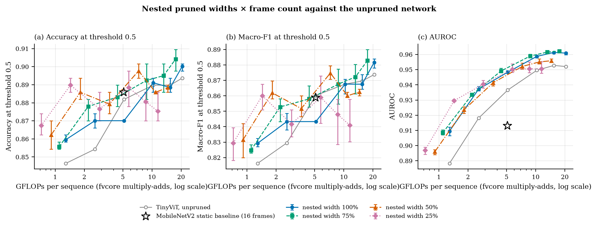
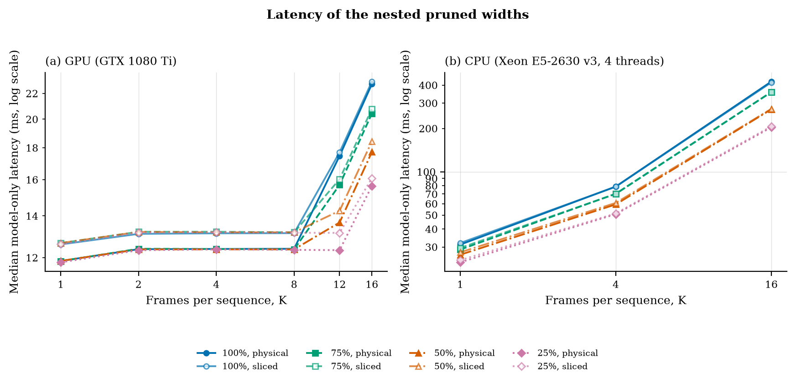
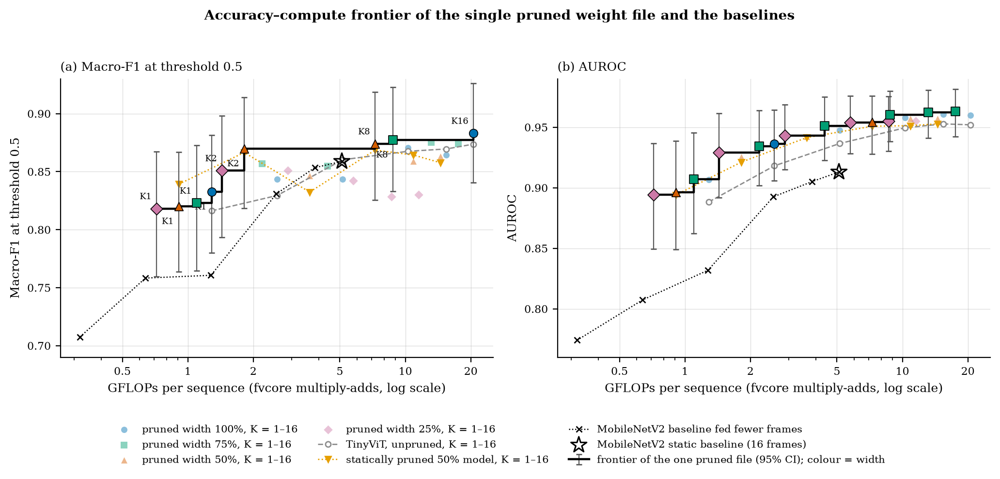
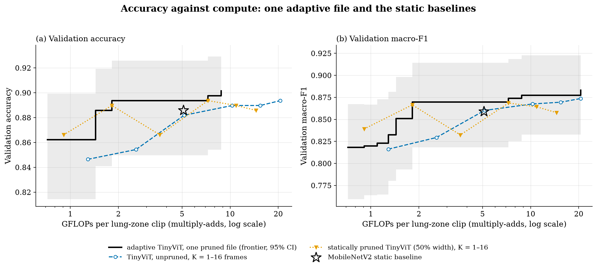

# F005 — Compressing the shared frame-count family (T011)

**Questions.** F005a: does INT8 post-training quantization of the one F004
weight set keep validation quality at every K, keep the family one artifact
with exact anytime upgrades, and cut size and CPU latency? F005b: can nested
structured pruning with distillation move every K point to fewer FLOPs while
keeping one weight file?

**Scope:** DAS-5, 2026-10-07, issue #13. T006 validation partition only (254
duplicate-aware units, 76 abnormal). No test-partition inference, no
calibration data and no training in F005a. F005b trains on the train split and
selects epochs on validation; its design and adoption rule are fixed in
`run_f005b.py` and below, before any F005b training result existed.

## F005a summary

- **Quality holds at every K.** Per-frame INT8 macro-F1 is within −0.009 to
  +0.008 of FP32 (every paired interval includes zero), AUROC within 0.006, and
  at most 5 of 265 rows change decision (Table 1).
- **One file, 3.2× smaller:** 20.4 MB → 6.4 MB for all six K (41 Linear
  layers in INT8; 61% of the multiply-adds).
- **Not faster on this CPU.** INT8 dynamic is 2–6% slower than FP32 with the K
  frames encoded together, and 1.06–1.62× slower one frame at a time (Table 1),
  measured against FP32 with frames encoded together, so the per-frame number
  mixes the batching cost with the INT8 cost (FP32 per frame was not timed).
- **Batch-dependent unless encoded per frame.** Encoding the K frames together
  changes a frame's INT8 features with its neighbours: logits move by up to 1.9
  against per-frame encoding (1e-5 in FP32). Per-frame INT8 keeps the anytime
  cache exact (tests).
- **FLOPs are unchanged** by quantization, so F005a does not move any point on
  the accuracy-vs-FLOPs plot. F005b addresses that.

**Table 1. F005a, validation and CPU latency per K.** Δ = paired macro-F1,
INT8 per-frame − FP32. Flips: rows whose decision at 0.5 changes. |Δlogit|:
median absolute logit change. Latency: model only, node209, 4 threads, median
of 5 round-robin repeats.

| K | FP32 macro-F1 | INT8 macro-F1 | Δ [95% CI] | FP32 AUROC | INT8 AUROC | INT8 accuracy | Flips | Median \|Δlogit\| | FP32 ms | INT8 batched ms | INT8 per-frame ms |
|---:|---:|---:|---|---:|---:|---:|---:|---:|---:|---:|---:|
| 1 | 0.816 | 0.824 | +0.008 [−0.008, +0.025] | 0.888 | 0.882 | 0.854 | 5 | 0.62 | 31 | 33 | 33 |
| 2 | 0.829 | 0.833 | +0.004 [−0.012, +0.020] | 0.918 | 0.917 | 0.858 | 3 | 0.58 | 50 | 52 | 66 |
| 4 | 0.860 | 0.851 | −0.009 [−0.028, +0.008] | 0.937 | 0.936 | 0.874 | 5 | 0.55 | 82 | 87 | 133 |
| 8 | 0.868 | 0.868 | +0.000 [+0.000, +0.000] | 0.950 | 0.950 | 0.890 | 0 | 0.51 | 184 | 189 | 265 |
| 12 | 0.870 | 0.874 | +0.004 [+0.000, +0.013] | 0.953 | 0.954 | 0.894 | 1 | 0.50 | 266 | 277 | 398 |
| 16 | 0.874 | 0.874 | +0.000 [+0.000, +0.000] | 0.952 | 0.953 | 0.894 | 0 | 0.49 | 374 | 391 | 531 |

FP32 on CPU reproduces the F004 GPU logits to 4.6e-5. Per-frame and batched
FP32 agree to 1.1e-5.

**Interpretation (F005a).** Dynamic INT8 is a working compression step for
memory: the same family in a third of the space, with no measurable quality
change. It is the wrong tool for latency here. Lecture 3 (part 2, slide 25)
names the reason: dynamic quantization computes activation ranges at run time,
which costs work, and our Linear layers are small (128–1280 wide), so the
quantize/dequantize steps outweigh the cheaper INT8 matrix products. The
Haswell-generation Xeon (E5-2630 v3) also lacks the VNNI INT8 instructions
of newer CPUs (not profiled).
Static quantization, with activation ranges fixed on calibration data, should
remove both the runtime overhead and the batch dependence; F005c tests it. The logit shift (median 0.5) matters for any T012 rule that uses
confidence: thresholds tuned on FP32 do not carry over.

## F005b design (fixed before training)

- **What is pruned.** The hidden channels of the twelve TinyViT blocks that
  have them: the two stage-0 MBConv blocks (expansion channels: conv1 out,
  depthwise conv2, conv3 in) and the ten transformer MLPs (fc1 out, fc2 in).
  They carry 59% of a frame's FLOPs; embedding widths and attention stay
  intact (`prune.py`).
- **Why no dependency graph tool.** Lab 2 used DepGraph (torch-pruning) because
  removing a channel in a network with skip connections forces coupled
  removals elsewhere (lecture 2, p. 66–70). Here every pruned channel lives in
  a closed group: an MLP hidden unit couples only fc1's output row and fc2's
  input column; an MBConv expansion channel couples conv1's output, its BN, the
  depthwise conv2 and its BN, and conv3's input. The residual stream and the
  embedding widths are never pruned, so no channel crosses a skip connection or
  an attention head. `prune.py` therefore slices the groups directly. That the
  pruned graph is valid is checked three ways: physically pruned copies equal
  the sliced runtime (tests), ONNX exports of every width match it to 8e-6, and
  fvcore counts the smaller tensors. The same choice caps the prunable share at
  59% of FLOPs.
- **Nested widths.** Channels are reordered by importance (function-preserving;
  tested) and width w keeps the first round(w·H) of each group, w ∈ {1.0,
  0.75, 0.5, 0.25}: 1.29 / 1.10 / 0.91 / 0.72 GFLOPs per frame. A smaller width
  uses a strict prefix of a larger width's weights, so one file serves every
  width and every K (the brief's "nested pruned models").
- **Importance.** L1 norm of each channel's in- and out-going weights (BN
  folded) or first-order Taylor (|Σ activation × gradient|) on 256 train rows
  (lecture 2, p. 40–43; per-channel activation form with the absolute value
  taken per sample, as in Molchanov et al. 2017; see the deviation table for
  how this differs from the slide's formula). In lecture 2's
  cost ladder (p. 46) L1 is the data-free rung and Taylor the gradient rung.
  Rule: the criterion with the lower train BCE at K16 when pruned without
  retraining, averaged over widths 0.75/0.5/0.25, on 300 other train rows.
  Per-stage sensitivity (one stage at 0.5) is recorded, not used.
- **Batch norm.** conv3's BN in each MBConv gets statistics per width, fitted
  on 32 train rows so its output matches full width in mean and spread (lecture
  4, p. 46: BN is width-dependent). Width 1.0 keeps D026's statistics.
- **Training.** From D026, train split only, F004b recipe (half the F002c
  learning rates, ≤ 10 epochs, patience 3). Sandwich rule per step: widths 1.0
  and 0.25 plus one of 0.75/0.5. Loss per width: mean over K ∈ {1, 2, 4, 8, 16}
  of 0.5·BCE(label) + 0.5·τ²·BCE against the frozen D026 teacher's softened
  output (τ = 2): offline distillation from the frozen unpruned parent (lecture
  5, p. 18). It is not lecture 4's in-place distillation, where the widest
  live subnet teaches the narrower ones in the same step (p. 64).
  Control: the same training at width 0.5 only. Seeds 2026–2028 for both.
- **Selection:** validation macro-F1 at 0.5 averaged over the 4 widths × 5 K
  (control: over the 5 K at width 0.5).
- **Adoption rule.** Propose the nested model as T011's compressed family if,
  averaged over the three seeds, (a) its width-1.0 mean macro-F1 over the five
  K is at least D026's − 0.01 and (b) its width-0.5 mean (29% fewer FLOPs per
  frame) is at least D026's − 0.02. The full width × K grid is reported either
  way.
- **Speed.** Training reads a uint8 cache of the K16 frames after resizing
  (`cache.py`, bit-identical to F002c preprocessing; `tests/test_f005.py`), so no JPEG is
  decoded during training.

## F005b results

**Table 2. Importance criterion** (train BCE at K16 on 300 zero-shot train
rows, after reordering and BN recalibration, before any training; unpruned
D026: 0.287).

| Criterion | Width 75% | Width 50% | Width 25% |
|---|---:|---:|---:|
| L1 | 0.563 | 0.615 | 0.714 |
| Taylor (chosen) | 0.347 | 0.315 | 0.611 |

One stage at width 50%, the rest full (Taylor): stage 0 0.347, stage 1
0.320, stage 2 0.253, stage 3 0.266. Stage 0 (the
convolutional stem) is the most sensitive; halving stage 2 alone does not raise
the train loss.

**Table 3. Nested widths × K** (validation, three seeds at their selected
epochs 5 / 7 / 9; macro-F1 mean and range; accuracy and AUROC means).

| Width | K | GFLOPs | Macro-F1 (mean, range) | Accuracy | AUROC | D026 macro-F1 at same K |
|---|---:|---:|---|---:|---:|---:|
| 100% | 1 | 1.29 | 0.829 (0.827–0.832) | 0.860 | 0.909 | 0.816 |
| 100% | 2 | 2.57 | 0.843 (0.838–0.849) | 0.870 | 0.937 | 0.829 |
| 100% | 4 | 5.15 | 0.843 (0.843–0.843) | 0.870 | 0.948 | 0.860 |
| 100% | 8 | 10.30 | 0.868 (0.861–0.871) | 0.891 | 0.959 | 0.868 |
| 100% | 12 | 15.45 | 0.868 (0.864–0.874) | 0.888 | 0.961 | 0.870 |
| 100% | 16 | 20.60 | 0.882 (0.878–0.884) | 0.900 | 0.961 | 0.874 |
| 75% | 1 | 1.10 | 0.825 (0.823–0.828) | 0.856 | 0.908 | 0.816 |
| 75% | 2 | 2.20 | 0.853 (0.843–0.858) | 0.878 | 0.933 | 0.829 |
| 75% | 4 | 4.39 | 0.858 (0.853–0.867) | 0.883 | 0.949 | 0.860 |
| 75% | 8 | 8.78 | 0.868 (0.855–0.877) | 0.892 | 0.959 | 0.868 |
| 75% | 12 | 13.17 | 0.872 (0.861–0.880) | 0.895 | 0.962 | 0.870 |
| 75% | 16 | 17.56 | 0.883 (0.874–0.890) | 0.904 | 0.962 | 0.874 |
| 50% | 1 | 0.91 | 0.831 (0.820–0.842) | 0.862 | 0.896 | 0.816 |
| 50% | 2 | 1.82 | 0.862 (0.858–0.870) | 0.886 | 0.924 | 0.829 |
| 50% | 4 | 3.63 | 0.852 (0.846–0.860) | 0.879 | 0.941 | 0.860 |
| 50% | 8 | 7.27 | 0.875 (0.871–0.879) | 0.898 | 0.952 | 0.868 |
| 50% | 12 | 10.90 | 0.860 (0.859–0.862) | 0.886 | 0.955 | 0.870 |
| 50% | 16 | 14.53 | 0.863 (0.860–0.864) | 0.888 | 0.956 | 0.874 |
| 25% | 1 | 0.72 | 0.829 (0.818–0.839) | 0.867 | 0.897 | 0.816 |
| 25% | 2 | 1.44 | 0.860 (0.851–0.867) | 0.890 | 0.930 | 0.829 |
| 25% | 4 | 2.88 | 0.842 (0.834–0.851) | 0.877 | 0.940 | 0.860 |
| 25% | 8 | 5.75 | 0.859 (0.842–0.873) | 0.888 | 0.950 | 0.868 |
| 25% | 12 | 8.63 | 0.848 (0.829–0.858) | 0.881 | 0.951 | 0.870 |
| 25% | 16 | 11.50 | 0.841 (0.830–0.858) | 0.875 | 0.950 | 0.874 |

**Adoption rule** (three-seed mean macro-F1 over the five trained K): D026
0.849; nested widths 100 / 75 / 50 / 25%: 0.853 /
0.857 / 0.856 / 0.846. Both conditions hold, so the rule
proposes the nested model. Control (width 50% trained alone): 0.854, against
0.856 for the nested 50% width.

Pareto front on macro-F1 (seed means, all 24 width × K points): w0.75_k16, w0.5_k1, w0.5_k2, w0.5_k8, w0.25_k1, w0.25_k2.

**Table 3b. Seed 2026, the deployable checkpoint** (macro-F1 and AUROC at K =
1 / 2 / 4 / 8 / 12 / 16; selected epoch 5).

| Width | Macro-F1 | AUROC |
|---|---|---|
| 100% | 0.832 / 0.843 / 0.843 / 0.871 / 0.864 / 0.883 | 0.907 / 0.936 / 0.948 / 0.958 / 0.961 / 0.960 |
| 75% | 0.823 / 0.857 / 0.855 / 0.877 / 0.875 / 0.874 | 0.907 / 0.934 / 0.951 / 0.960 / 0.962 / 0.963 |
| 50% | 0.820 / 0.870 / 0.846 / 0.874 / 0.859 / 0.863 | 0.896 / 0.925 / 0.942 / 0.954 / 0.957 / 0.957 |
| 25% | 0.818 / 0.851 / 0.851 / 0.842 / 0.829 / 0.830 | 0.894 / 0.929 / 0.943 / 0.954 / 0.955 / 0.955 |
| D026 (unpruned) | 0.816 / 0.829 / 0.860 / 0.868 / 0.870 / 0.874 | 0.888 / 0.918 / 0.937 / 0.950 / 0.953 / 0.952 |

Paired against D026 at the same K (exact McNemar on correctness at 0.5), one of
the 72 seed × cell tests falls below 0.05: seed 2026, 50% width at K2, +0.040
(14 / 4 units, p = 0.031). With 72 uncorrected tests about four such hits are
expected by chance, so no single cell is evidence of a difference. The seed-2026
25% width falls 0.041 and 0.043 below D026 at K12 and K16 (11 / 17 units at K16,
p = 0.34).

**Figure 3.** Validation quality against cost for the four nested widths
(three seeds: markers at the mean, bars to the range) and the unpruned D026
family (grey, open circles). (a) Accuracy and (b) macro-F1 at threshold 0.5;
(c) AUROC. Cost: fvcore GFLOPs per sequence of the physically pruned width
(log scale). Star: MobileNetV2 F002b static baseline.


**Table 4. Latency of the widths** (seed 2026, model only, median of 5
round-robin repeats; GPU: node201, GTX 1080 Ti, exclusive, 200 requests; CPU:
node207, Xeon E5-2630 v3, 4 threads, 50 requests). Physical: a separately pruned
copy; sliced: the one nested file with the width chosen at run time.

| Width | GPU physical ms, K1 / K4 / K8 / K16 | GPU sliced ms | CPU physical ms, K1 / K4 / K16 | CPU sliced ms |
|---|---|---|---|---|
| 100% | 11.8 / 12.4 / 12.4 / 22.8 | 12.6 / 13.1 / 13.1 / 23.0 | 31 / 79 / 423 | 32 / 79 / 418 |
| 75% | 11.8 / 12.4 / 12.4 / 20.4 | 12.7 / 13.2 / 13.2 / 20.8 | 29 / 70 / 358 | 30 / 70 / 357 |
| 50% | 11.9 / 12.4 / 12.4 / 17.7 | 12.7 / 13.2 / 13.2 / 18.4 | 27 / 59 / 272 | 28 / 61 / 273 |
| 25% | 11.8 / 12.4 / 12.3 / 15.6 | 12.6 / 13.2 / 13.1 / 16.1 | 23 / 51 / 204 | 24 / 51 / 207 |

On the CPU latency falls with width roughly as FLOPs do (K16: 423 → 204 ms at
the 25% width, −52%, for −44% FLOPs). On the GPU it does not change below K12,
where the GPU is not filled, and falls by up to 31% at K16. Choosing the width
at run time inside the one nested file costs 0.2–0.8 ms on the GPU and at most
3% on the CPU over separately pruned copies. Absolute times differ from F004's
jobs (for example 11.9 against 9.9 ms at K1 on the same GPU host), so widths
are compared only within this job.

**Figure 4.** Median model-only latency per width and K, physically pruned
copies (filled markers) and the sliced nested file (open markers); (a) GPU, (b)
CPU. Seed-2026 checkpoint.


**Table 5. Size, ONNX and calibration per width** (seed 2026; `extras`).
Density: parameters relative to full width. ONNX: largest feature difference
between the exported physically pruned encoder (ONNX Runtime, CPU) and the
sliced nested model on 32 validation frames. ECE: expected calibration error of
the abnormal probability, 10 bins, at K1 / K4 / K16 (unpruned D026:
0.132 / 0.080 / 0.079).

| Width | GFLOPs per frame | Parameters | Density | Physical copy MB | ONNX Δ | ECE |
|---|---:|---:|---:|---:|---:|---|
| 100% | 1.29 | 5,072,085 | 1.00 | 20.4 | 6e-06 | 0.120 / 0.091 / 0.078 |
| 75% | 1.10 | 4,269,845 | 0.84 | 17.2 | 6e-06 | 0.112 / 0.080 / 0.071 |
| 50% | 0.91 | 3,467,605 | 0.68 | 14.0 | 3e-06 | 0.130 / 0.085 / 0.078 |
| 25% | 0.72 | 2,665,365 | 0.53 | 10.8 | 8e-06 | 0.115 / 0.084 / 0.087 |

The nested file holds every width in 20.4 MB; four separate pruned copies
would take 62.5 MB. Training cost (lecture 2's recovery cost): nested
25 / 30 / 31 min, single-width control 7 / 6 / 6 min per seed
on one Titan RTX.

**Figure 5.** The accuracy–compute frontier of the deployable seed-2026 file.
Light markers: all 24 width × K points (colour and marker = width). Black step
line: the Pareto front over those points, with each front point's 95%
unit-bootstrap interval; front points are drawn in their width's colour, K
labelled in (a). Grey dashed: the unpruned TinyViT at K = 1–16. Orange dotted:
the model trained only at 50% width (a statically pruned baseline). Black
dotted crosses: the frozen MobileNetV2 baseline fed fewer frames; star: the
MobileNetV2 static baseline at 16 frames. (a) Macro-F1 at threshold 0.5; (b)
AUROC. Validation units; the same units selected the epochs.


**Table 5b. Weight sharing in the deployable file** (seed 2026, `weights`,
`f005b_weights.json`; the brief's tip: compare layer weights in torch). For
each width, every encoder parameter of the physically pruned copy is compared
with the nested file's tensor; the binary head (2 tensors) is shared whole.

| Width | Encoder tensors equal to a prefix of the nested tensor | Of which sliced | Encoder parameters |
|---|---:|---:|---:|
| 25% | 213 of 213 | 44 | 2,665,044 |
| 50% | 213 of 213 | 44 | 3,467,284 |
| 75% | 213 of 213 | 44 | 4,269,524 |
| 100% | 213 of 213 | 0 | 5,071,764 |

Every smaller width is a strict prefix of the nested weights. The only data
kept per width are 16 BN statistic buffers (the 2 MBConv conv3 BNs × 4 widths
× running mean and variance; γ and β are shared). So the file is "shared
weights plus per-width BN statistics", as in slimmable networks (lecture 4,
p. 46), rather than a strict subset in every byte.

**Deployable artifact.** The T011 system is the FP32 seed-2026 nested
checkpoint (`artifacts/F005/train/nested_seed2026/checkpoint.pt`, 20.4 MB), run
through `prune.py`'s sliced runtime at any of the 4 widths × 6 K; the physically
pruned ONNX encoders per width are export checks, not separate deliverables.
INT8 is not part of the deployed system: dynamic INT8 would only shrink the
file and was measured on the unpruned family, not on the pruned file.

**Figure 6.** Slide version: (a) validation accuracy, as the brief's Pareto
plot asks, and (b) macro-F1, the primary metric. Each panel shows the frontier
of the deployable file for that metric (black step line, 95% interval shaded:
Wilson for accuracy, unit bootstrap for macro-F1), the unpruned TinyViT (blue),
the model trained only at 50% width (orange) and the MobileNetV2 static
baseline (star). GFLOPs are fvcore multiply-adds per lung-zone clip. Validation
units; the same units selected the epochs, so the frontier's best steps are
optimistic.


**Interpretation (F005b).**

- **Pruning moves the family left, within noise of the unpruned quality.**
  Averaged over seeds, the 50% width (29% fewer FLOPs per frame) is within
  0.011 of D026's macro-F1 at every K and above it at K1, K2 and K8; the 25%
  width (44% fewer) is within 0.033. For the deployable seed 2026 the 25% width
  is 0.04 lower at K12/K16. Single front points such as 25% width at K2 (1.44
  GFLOPs, seed mean 0.860 against D026-K4's 0.860) or 50% width at K8 (7.27
  GFLOPs, 0.875 against D026-K16's 0.874) are local peaks: the same widths score
  0.842 and 0.860 one K further along. The defensible reading is "about the
  unpruned quality at 29–44% fewer FLOPs per frame, with more spread at 25%".
  All of it comes from the validation units that also chose the epochs; T013
  measures it on unseen data.
- **Two effects are mixed in "against D026".** Fine-tuning with distillation
  alone moves the full width above D026 (100% width: +0.013 at K1, +0.014 at
  K2, AUROC +0.01–0.02; F004b's fine-tunes also raised AUROC without pruning).
  Against its own 100% width (mean over the five K 0.853), the 75% and 50%
  widths lose nothing (0.857, 0.856) and the 25% width loses 0.007 (0.846).
  AUROC stays at or above the unpruned family at every cost, by as little as
  0.001 for 25% width at K16.
- **The deployed weights are fine-tuned across K.** F005b trains every width
  on a loss over five K with distillation, so the deployable file carries the
  multi-K fine-tune that F004b did not adopt on its own. It is accepted here
  under a different, non-inferiority rule, as part of the compression step.
- **A static single-width model can beat the nested file at a single point.**
  The model trained only at 50% width scores 0.839 at K1 (0.91 GFLOPs), above
  the nested file's frontier at that cost (seed 2026). What the nested file
  adds is the whole range from one file, not higher quality at each point.
- **Nesting costs training time, not quality.** The 50% width inside the nested
  model scores like a model trained only at 50% (0.856 vs 0.854), but nested
  training takes about 4× the compute of one width (1,500–1,830 s against
  370–450 s per seed on a Titan RTX; lecture 2's recovery-cost metric).
- **Narrow widths are noisier over K.** The 25% width's macro-F1 does not rise
  with K the way the full width's does (0.860 at K2, 0.841 at K16), and the seed
  range widens to about 0.03. Its AUROC still rises with K, so the
  threshold-0.5 decision, not the ranking, is what varies.
- **Taylor beats L1 without retraining**, by a wide margin at every width,
  and Taylor order beats a random order after full recovery (Follow-ups: −0.10
  macro-F1 for random at 25% width). Taylor against L1 after recovery is not
  run. The train BCE is also partly a
  calibration measure here (Taylor at 50% scores lower than at 75%, and stage 2
  alone at 50% lower than the unpruned model), so "Taylor damages less" is
  supported, "Taylor is better after training" is not tested. Stage 0 is the
  most sensitive; F005b uses one ratio for all stages and does not allocate
  sparsity by sensitivity (lecture 2, p. 50).
- **Limits of the BN handling.** Only conv3's BN in the two MBConv blocks gets
  statistics per width. The BNs after the pruned MLPs (local convolutions,
  patch merging) keep D026's statistics at every width; lecture 4 (p. 46)
  recalibrates all of them. Training and evaluation use the same statistics, so
  the reported numbers are consistent. Recalibrating every BN after training
  was tested and lowers the narrow widths (see Follow-ups).

## Follow-ups after review

**Width-aware anytime serving.** `NestedAnytimeClip` (`prune.py`) caches frame
features per (width, frame): moving up in K at one width encodes only the
added frames, and a width change encodes the K frames anew at the new width,
keeping the old width's features for a move back. A test serves one clip
through (100%, K4) → (50%, K8) → (50%, K16) → (100%, K8) → (25%, K1) and
matches direct inference at every step, encoding 4, 8, 8, 4 and 1 frames.
`AnytimeClip` (F004) caches by frame only and must not be used across widths.

**Switching width and K between requests** (`switching`, seed 2026, sliced
nested file; F004's method: the same requests with (width, K) drawn per request
and grouped, 5 alternating repeats). GPU (GTX 1080 Ti, all 24 cells, 1,000
requests, 960 changes): per-cell median latency moves by −0.3% to +0.3%, at
most 0.6% in any repeat. CPU (Xeon E5-2630 v3, 4 threads, K1/K4/K16, 240
requests, 223 changes): −2.5% to +3.6%, inside the 13% repeat-to-repeat spread
of the grouped order itself. Changing width and K per request costs nothing
measurable beyond the chosen point's own compute.

**Full per-width BN recalibration (post hoc, rule fixed first: adopt if the
three-seed mean over widths 75/50/25% × five K rises by ≥ 0.005).** All 19 BNs
downstream of a pruned layer (10 local-convolution, 9 patch-merging) got
moment-matched statistics per width on the 32 calibration rows, after training,
for all three seeds. Mean macro-F1, conv3-only → all BNs: 100% 0.853 → 0.853
(unchanged by construction), 75% 0.857 → 0.853, 50% 0.856 → 0.848, 25%
0.846 → 0.835; change over the narrow widths -0.008. Not adopted. The
network was fine-tuned with those BN statistics frozen, so its weights adapted to
them; re-estimating them afterwards moves it away from what it learned.
Lecture 4's per-width BN (p. 46) applies when the statistics are per width
during training, which F005b did only for conv3.

**Random channel order after recovery** (control added after review; one
random order per group, generator seed 2026, otherwise identical nested
training, seeds 2026–2028, selected epochs 9 / 8 / 4). Three-seed mean over the
five trained K:

| Width | Macro-F1, Taylor order | Macro-F1, random order | Difference | AUROC, Taylor | AUROC, random |
|---|---:|---:|---:|---:|---:|
| 100% | 0.853 | 0.850 | -0.003 | 0.943 | 0.940 |
| 75% | 0.857 | 0.831 | -0.026 | 0.942 | 0.928 |
| 50% | 0.856 | 0.829 | -0.027 | 0.934 | 0.922 |
| 25% | 0.846 | 0.743 | -0.104 | 0.934 | 0.859 |

On the three narrow widths every Taylor seed (0.850–0.855) beats every random
seed (0.797–0.807). The importance order matters after recovery, and more the
more is removed: at 25% width a random choice of channels costs 0.10 macro-F1
and 0.075 AUROC that this training budget (at most 10 epochs at half the
original learning rate, with the random runs still improving slowly at the
end) does not win back. A longer recovery might narrow the gap. At full width, where
nothing is removed, the two orders agree, as they should.

## F005c, static INT8 (exploratory)

ONNX Runtime static quantization of the per-frame encoder (QDQ, per-channel
INT8 weights, UINT8 activations; `run_f005c.py`), calibrated on train frames,
applied to D026. A first configuration (every operator, MinMax ranges, 64
calibration rows) raised train BCE at K16 from 0.287 to 0.548, and Percentile
calibration on 1,024 frames ran out of 32 GB. The second, recorded in
`CONFIG`, quantizes only Conv/MatMul/Gemm on 16 calibration rows: train BCE
0.397 (MinMax) and 0.309 (Percentile, chosen).

Validation (Percentile): macro-F1 0.790 / 0.816 / 0.828 / 0.851 / 0.857 / 0.872
at K1–K16 against FP32's 0.816 / 0.829 / 0.860 / 0.868 / 0.870 / 0.874; AUROC
0.867 / 0.917 / 0.940 at K1 / K4 / K16 against 0.888 / 0.937 / 0.952; median
logit change 1.3–1.6. Frames encoded together and one by one give identical
features (fixed scales). On the CPU (node209, 4 threads) the INT8 encoder is
1.5–1.8× slower than the FP32 encoder in ONNX Runtime (K16: 499 vs 283 ms).

**Interpretation (F005c).** Static INT8 removes the batch dependence, as
expected, but in this configuration it lowers AUROC and is slower. This is not
a general verdict on static INT8. The configuration (UINT8 activations × INT8
weights without `reduce_range`, on an AVX2 CPU without VNNI) is the one ONNX
Runtime warns can saturate, and "MatMul" also covers the activation ×
activation attention products. Lecture 3 (p. 28–30) keeps sensitive operators
such as softmax and normalization in higher precision; extending that to the
attention products is our own hypothesis, untested. The macro-F1 differences all have intervals that include
zero; the AUROC drop has no interval. A third run with `reduce_range=True`
(7-bit weights, ONNX Runtime's remedy for that saturation) did not help: train
BCE 0.392 (Percentile, chosen) against 0.309, validation macro-F1 0.779 / 0.792
/ 0.819 / 0.825 / 0.838 / 0.862 at K1–K16, and the same 1.5–1.8× slowdown (K16:
519 vs 289 ms). Saturation is therefore not the explanation; quantizing the
attention products, or simply the sensitivity of this small network to 8-bit
activations, remains possible and is not separated. Quantization-aware training
and a VNNI CPU are untested. Dynamic INT8 (F005a) is the variant worth keeping,
for file size only.

## Where this differs from the lecture material

Slide numbers are PDF pages of the course slides in the vault (L2 pruning, L3
part 2 quantization, L4 adaptive inference, L5 distillation). Rows marked
"follows" are listed where a reader might expect a deviation.

| Lecture suggestion | What F005 does | Why, and the evidence |
|---|---|---|
| Prune with a dependency-graph tool (Lab 2, DepGraph / torch-pruning; L2 p. 66–70) | Slices closed channel groups directly in `prune.py` | No pruned channel crosses a residual or attention head, so there is no coupling to track; validity checked by physical = sliced, ONNX per width and fvcore |
| Transformer pruning units include attention heads and Q/K/V/O (L2 p. 26, p. 70; head-aware slicing in SHARD, L4 p. 62) | MLP hidden units and MBConv expansion channels only | A head is also a closed group, so this is a scope choice, not a necessity. TinyViT-5M has 2 / 4 / 5 / 10 heads per stage, and 5 heads cannot follow a 75 / 50 / 25% schedule; timm also fuses Q/K/V and keeps per-head attention biases. The MLPs carry the larger FLOP share (41.5% against 21% for the attention projections). Together with the MBConv channels this caps the prunable share at 59% of FLOPs |
| First-order Taylor score per unit, I(u) = \|Σ w · ∂L/∂w\| with the gradient summed over the batch inside the absolute value (L2 p. 42) | \|a · ∂L/∂a\| for each channel's output, absolute value per sample, then summed over 256 train clips (as in Molchanov et al.) | Two real differences: the per-sample absolute value avoids gradients cancelling across samples at a converged model (the noise L2 p. 43 warns about), and only the channel's outgoing contribution counts, not fc1's row and bias. Per sample, the activation form equals the outgoing-weight form exactly |
| Allocate sparsity by layer sensitivity, not uniformly (L2 p. 50) | One width ratio for every group; per-stage sensitivity measured, not used | A single width multiplier keeps the nested prefix and the runtime choice simple; stage 0 is the most sensitive and a per-stage allocation is untested |
| Iterative pruning can preserve accuracy better at high compression (L2 p. 51) | One-shot to all widths, then fine-tuning | Time budget; the 25% width is the one most likely to gain from it |
| Physically remove pruned units for deployment (L2 p. 48) | Deploys one nested file sliced at run time; physical copies only for counting and export | One artifact for all widths; slicing costs 0.2–0.8 ms on GPU and ≤ 3% on CPU over physical copies |
| Width-dependent BN, e.g. switchable BN with its own parameters and statistics per width (L4 p. 46) | Per-width running statistics only for the 2 MBConv conv3 BNs; γ and β stay shared; the statistics are set by matching the full-width output moments rather than re-estimated per width; the other BNs keep D026's | conv1/conv2 BNs act per channel and LayerNorm does not depend on width, so conv3 is the only BN whose input sum changes inside the pruned blocks. Recalibrating all 19 downstream BNs after training lowered the narrow widths by 0.008; per-width BN during training is untested |
| Train widths by sampling a subset per step (L4 p. 47) | Follows: sandwich rule (widest, narrowest, one random middle width) | — |
| The largest subnet teaches the smaller ones (L4 p. 64, in-place distillation); the full model guides the cheaper paths (L4 p. 35–36) | Offline distillation from the frozen unpruned D026, at the same K as the student | A fixed teacher cannot drift with the student; F004b showed that fine-tuning moves the full width. Because the teacher is also the student's initialisation, this sits between offline KD and self-distillation (L5 p. 18). A K16 teacher for every K, which follows L4 p. 35–36 more closely and might lift K1/K2, is untested |
| Distillation loss CE + τ²·KL over soft class targets that carry "dark knowledge" (L5 p. 8, p. 11) | For one binary logit: 0.5·BCE(label) + 0.5·τ²·BCE against the teacher's softened probability, τ = 2 | The binary form of the same loss (soft-target BCE equals the KL plus a constant). With two classes there is no class-similarity structure to transfer, so the soft targets act mainly as a regulariser on confidence (L5 p. 24) |
| Prune, then regrow with shared weights (Elastoformer, L4 p. 58) | Prune only, no regrowth | Nested prefixes already give shared weights; regrowth adds a training stage |
| Static quantization can be faster than dynamic (L3 p. 25) | Not compared head to head: dynamic INT8 ran in PyTorch eager (2–6% slower than its FP32), static INT8 in ONNX Runtime (1.5–1.8× slower than its FP32, and less accurate) | Each against its own FP32 baseline on a CPU without VNNI; the `reduce_range` rerun rules out weight saturation; the ONNX Runtime graph was not profiled for fallbacks (L3 p. 30, p. 44) |
| QAT usually beats PTQ at low precision (L3 p. 41–43) | PTQ only | INT8 bought file size only on this hardware, so QAT was not worth the training cost here |
| Calibration methods: min–max, percentile, MSE, KL (L3 p. 37) | Min–max and percentile | Memory limit of activation collection in ONNX Runtime |
| Weights per-channel, and protect sensitive first and last layers (L3 p. 23, p. 29) | Dynamic INT8 uses PyTorch's default per-tensor weight scales and also quantizes the binary head | Default `quantize_dynamic` configuration; quality held anyway (all paired intervals include zero) |
| Prune, then quantize, often with distillation (L5 p. 21, p. 67) | Both INT8 variants were applied to the unpruned D026, never to the pruned file | INT8 gave no speed on this CPU, so the combination was not pursued; dynamic INT8 on the pruned file would add a 3× size cut |
| FLOPs ≈ 2 × MACs (L2 p. 56) | "GFLOPs" throughout are fvcore counts with one multiply-add = one FLOP, i.e. GMACs | One convention for every point and baseline, as the brief requires; double the numbers for the 2 × MAC convention |
| Brief tip: train on DAS-6 | DAS-5 | The course labs and our account run on DAS-5 |
| Report runtime memory and energy (L2 p. 57, p. 59; L4 p. 30) | Neither per width; F004 reports GPU memory per K for the unpruned family | No power measurement on the DAS-5 nodes used; a stated limit |
| Report recovery cost (L2 p. 61) | Follows: nested ≈ 4× the training time of one width | — |

## Method

**Scheme.** `torch.ao.quantization.quantize_dynamic` on every `nn.Linear` of
the F004 family (`compress.py`): 41 layers (attention qkv/proj, MLP fc1/fc2,
the binary head) store INT8 weights with per-tensor scales and quantize their
input activations on each call. Convolutions (stage 0 and patch embedding),
attention matmuls, norms and softmax stay FP32. Linear layers execute 61% of
the family's fvcore FLOPs at every K (F004 `flops.json`). Quantized engine
`x86` on the DAS-5 Xeons.

**Why two INT8 modes.** Dynamic quantization takes each Linear's activation
scale from its whole input tensor. When the K frames of a request are encoded
together (`batched`), a frame's features depend on the other frames in the
request. F004's anytime cache then no longer reproduces direct inference.
Encoding frames one at a time (`per_frame`) removes that dependence; it is the
deployable INT8 mode, and `AnytimeClip` takes it as its `encode` function.
FP32 is the same in both modes up to float rounding.

**Validation.** For every validation row, the 16 F004 frames are encoded per
frame in FP32 and INT8, and each K's logit is pooled from its nested subset.
Every K is also run batched in both precisions. Metrics as in F004: duplicate-aware
units, threshold 0.5, 95% unit-bootstrap intervals (1,000 resamples,
seed 2026) for macro-F1 and AUROC, paired macro-F1 difference and exact
McNemar against FP32 at the same K.

**Cost.** fvcore FLOPs are unchanged by quantization (they count
multiply-adds, not their precision), so the table reports the share executed
in INT8 instead of a new FLOP count. Size is the serialized state dict. CPU
latency: model only, preloaded inputs, the first 50 F002 §9 timing requests,
5 warm-up requests per repeat, 5 repeats run round-robin over all
configurations in one job, 4 threads on an exclusively allocated node.

## Commands

From the repository root on DAS-5 (`myenv`). F005a, both on CPU nodes:

```bash
sbatch -w node208 --exclusive --gres=gpu:0 --time=04:00:00 experiments/F005/das5_f005.sbatch evaluate --threads 16
sbatch -w node209 --exclusive --gres=gpu:0 --time=04:00:00 experiments/F005/das5_f005.sbatch benchmark --threads 4
python experiments/F005/create_figures.py                      # needs matplotlib
```

F005b (`das5_f005b.sbatch`):

```bash
S=experiments/F005/das5_f005b.sbatch
sbatch --gres=gpu:0 $S cache --partition train
sbatch --gres=gpu:0 $S cache --partition validation
sbatch --constraint=TitanRTX $S importance
for seed in 2026 2027 2028; do for mode in nested single; do
  sbatch --constraint=TitanRTX --time=06:00:00 $S train --mode $mode --seed $seed; done; done
sbatch --gres=gpu:0 $S evaluate
sbatch -w node201 --exclusive $S benchmark --device cuda
sbatch -w node207 --exclusive --gres=gpu:0 --time=06:00:00 $S benchmark --device cpu --threads 4
```

F005c (`das5_f005c.sbatch`, CPU nodes): `prepare`, `evaluate` and `benchmark`
with `--model d026`.

Tests: `python -m unittest tests.test_f005`.
