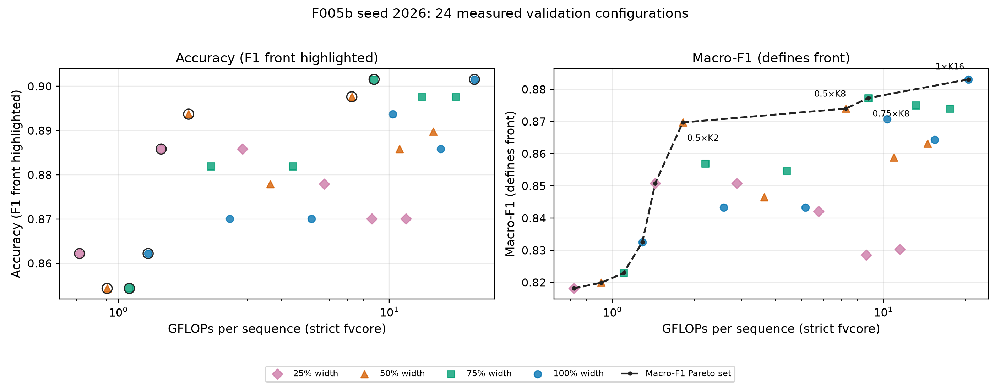

# F006a — T012a resource-aware controller design

**Research question.** Which configurations of the accepted D029 nested TinyViT
family are useful for a deterministic FLOP-budget policy, and what trade-off rule
should the team approve before T012b implements and simulates the controller?

This is a validation-only analysis of the **deployable F005b seed-2026 checkpoint**.
It does not train a model, implement a runtime controller, use test images, or
accept a new policy decision. D027–D029 and the T006/F002 frozen foundation stay
in force. T012a examines the 4 widths × 6 nested K values; T012b will implement
and simulate the rule after Charalampos and Salo decide the open items below.

## Evidence and reproduction

- Full-precision duplicate-aware macro-F1 and accuracy at threshold 0.5 come
  from the selected epoch 5 in the canonical
  [`run.json`](../../checkpoints/f005b_nested_seed2026/run.json), SHA-256
  `47710bc9f918576b5698d2f0eeaa3f6f1c7de127b483cd7c3e387f735e131bec`.
  These represent 254 known-dependency-collapsed validation units from 265 rows.
- Integer model FLOPs are **recomputed**, not copied from a rounded table, using
  the strict F003 fvcore counter, each physically pruned width of the canonical
  [`checkpoint.pt`](../../checkpoints/f005b_nested_seed2026/checkpoint.pt)
  (SHA-256 `18d601e3ea04a1ba572ef99484c8681c5a3011dd7d3eb28309cb32906ff9e702`),
  and an `AdaptiveTinyViT` wrapper for every K. The canonical loader verifies
  that checkpoint and its Taylor
  [`importance.pt`](../../checkpoints/f005b_nested_seed2026/importance.pt).
  F003/F005 count one multiply-add as one FLOP; this is model work, not latency.
- The canonical run lacks AUROC and per-unit probabilities. The original ignored
  `artifacts/F005/f005b_evaluation.json` and selected-unit prediction files are
  unavailable locally. The table therefore reports seed-2026 AUROC only to the
  **three decimal places** printed in F005 README Table 3b. It does not use the
  Table 3 three-seed averages for deployment choices. No AUROC precision or
  paired comparison is inferred from aggregate confusion counts.

With the existing project Python environment and dependencies used for F005:

```bash
python experiments/F006a/run_analysis.py
python experiments/F006a/run_analysis.py --check
python -m unittest tests.test_f006a
```

The script reads only the tracked run, checkpoint, importance order and F005
README. FLOP tracing uses synthetic zero tensors; it loads no OpenPOCUS frames or
T006 test manifest. It writes deterministic
[`configurations.csv`](configurations.csv),
[`budget_sensitivity.csv`](budget_sensitivity.csv) and a presentation-ready
[`PNG`](figures/pareto.png) / [`PDF`](figures/pareto.pdf) figure. `--check`
recomputes all 24 FLOP counts and compares the table bytes. The figure shows
all configurations in both accuracy and macro-F1 panels; its highlighted
frontier is defined by **macro-F1**, including in the accuracy panel.



## Strict Pareto comparison

Configuration A dominates B only if A uses no more FLOPs, has no lower
macro-F1, and improves at least one of those values. Exact integer FLOPs and
the unrounded selected-run macro-F1 are compared, without a tolerance. The
CSV reports all **24 cells**, including the **15 dominated cells**, with one
valid witness for each: highest macro-F1 among dominators, then lowest cost,
then name. Nine cells are nondominated:

| Width × K | GFLOPs | Validation macro-F1 | Δ GFLOPs from prior front point | Δ macro-F1 | Cost increase | Δ F1 per GFLOP |
|---|---:|---:|---:|---:|---:|---:|
| 0.25 × 1 | 0.718804427 | 0.818167 | — | — | — | — |
| 0.50 × 1 | 0.908287819 | 0.819944 | 0.189483392 | 0.001777 | 26% | 0.009381 |
| 0.75 × 1 | 1.097771211 | 0.822903 | 0.189483392 | 0.002959 | 21% | 0.015614 |
| 1.00 × 1 | 1.287254603 | 0.832476 | 0.189483392 | 0.009573 | 17% | 0.050521 |
| 0.25 × 2 | 1.437608515 | 0.850851 | 0.150353912 | 0.018376 | 12% | 0.122215 |
| 0.50 × 2 | 1.816575299 | 0.869706 | 0.378966784 | 0.018855 | 26% | 0.049754 |
| 0.50 × 8 | 7.266300179 | 0.874008 | 5.449724880 | 0.004301 | 300% | 0.000789 |
| 0.75 × 8 | 8.782167315 | 0.877288 | 1.515867136 | 0.003280 | 21% | 0.002164 |
| 1.00 × 16 | 20.596068563 | 0.883089 | 11.813901248 | 0.005802 | 135% | 0.000491 |

Strict efficiency is not evidence that every step is worthwhile. The 0.50 × 2
to 0.50 × 8 step roughly quadruples compute for +0.00430 validation F1; the
0.75 × 8 to 1.00 × 16 step more than doubles compute for +0.00580. Conversely,
the full-width K16 point has higher abnormal recall than 0.50 × 2 (0.842 vs
0.776 from their selected-run confusion counts) and higher reported AUROC
(0.960 vs 0.925, rounded); neither cheap configuration nor full K16 is a
universal winner on all quality measures. Accuracy has a different Pareto set:
1.00 × 16 equals 0.75 × 8 in accuracy (229/254) at higher cost, yet remains
macro-F1 efficient. This analysis uses the primary macro-F1 definition.

## Proposed FLOP budget mapping and candidate rules

For human approval, propose `B(b) = b × Cmax`, where `Cmax` is the exact
full-width K16 count, **20.596068563 GFLOPs**. The already accepted `b = 0.00`
defers inference. For an active state, only points with integer FLOPs at or
below the exact fractional budget are feasible. A point may leave budget unused,
and states may share one point.

**Recommended provisional rule A:** choose the feasible macro-F1 Pareto point
with highest seed-2026 validation macro-F1; exact ties go to lower FLOPs and
then configuration name. It imposes no unexplained quality-loss tolerance and
uses the budget itself to constrain computation. It is a transparent T012b
baseline, **not yet an accepted controller policy**.

| b | Permitted GFLOPs | Rule A width × K | Actual GFLOPs | Validation macro-F1 | Budget used |
|---:|---:|---|---:|---:|---:|
| 0.25 | 5.14901714075 | 0.50 × 2 | 1.816575299 | 0.869706 | 35.3% |
| 0.50 | 10.29803428150 | 0.75 × 8 | 8.782167315 | 0.877288 | 85.3% |
| 0.75 | 15.44705142225 | 0.75 × 8 | 8.782167315 | 0.877288 | 56.9% |
| 1.00 | 20.59606856300 | 1.00 × 16 | 20.596068563 | 0.883089 | 100% |

The CSV also compares two deterministic alternatives at every active budget:

- **Rule B, cheap near-best:** choose the cheapest feasible Pareto point within
  absolute `ε` macro-F1 of Rule A. The illustrative sensitivity grid
  `ε ∈ {0, 0.005, 0.010, 0.015, 0.020}` is **not** an adopted tolerance. At
  `ε = 0.005`, the `b = 0.50/0.75` choices move from 0.75 × 8 to 0.50 × 8;
  at `ε = 0.010` they move to 0.50 × 2. At `b = 1.00`, `ε = 0.010` chooses
  0.50 × 8; `ε = 0.015` chooses 0.50 × 2. This sensitivity precludes claiming
  that one cheap set is compelled by the validation scores.
- **Rule C, cost-aware score:** maximize `macro-F1 − λ × GFLOPs/Cmax` among
  feasible Pareto points, preferring lower FLOPs on exact ties. Here `λ` is the
  F1 value assigned to a full `Cmax` of work. The grid
  `λ ∈ {0, 0.005, 0.010, 0.020, 0.030}` is illustrative, not an adopted
  resource valuation. For `b = 1.00`, `λ = 0.010` keeps 1.00 × 16, while
  `λ = 0.020` prefers 0.75 × 8. Choosing `λ` is a team/use-case decision,
  not something the validation grid can establish by itself.

The `b = 0.25` Rule A point is much cheaper than its budget because spending
more within that state did not improve macro-F1 in the selected checkpoint.
The four active states under Rule A use three distinct configurations; no count
of configurations was imposed in advance.

## Robustness, interpretation and limits

The F005 README's three-seed results are **supporting robustness evidence**, not
the target of configuration selection. They reverse some small seed-2026
rankings: 0.50 × 8 averages 0.875 versus 0.75 × 8 at 0.868, whereas the
selected checkpoint scores 0.874 versus 0.877. At K16 the three-seed means
for full and 75% width are 0.882 and 0.883, while seed 2026 scores 0.883 and
0.874. The selected-run 0.50 × 2 versus 0.25 × 2 difference is 0.0189, but
the three-seed means differ by only 0.002. These shifts make small observed
advantages fragile; none is treated as established superiority.

The original paired per-unit probabilities and numeric bootstrap intervals are
absent here, so no new paired intervals or significance claims are computed.
F005's plotted unit-bootstrap bands and reported three-seed ranges convey
uncertainty but cannot certify a pairwise winner from this repository snapshot.
Validation chose the F005b epoch and now informs policy design, so the frontier
may be optimistic. In particular, some narrow-width macro-F1 values fall as K
increases although AUROC rises. The 25% width is noisy across seeds. The
OpenPOCUS task is a technical proxy, not a clinical performance claim.

FLOPs do not establish latency on CPU-class edge hardware. Before T012b
translates this mapping into latency constraints, measure the **selected F005b
pruned width × K points with chunked encoding in one comparable CPU job**.
F004's chunk-of-four timing was for the unpruned family. Width switching must
use F005's `NestedAnytimeClip`, which keys its cache by width and frame.

## Decisions Charalampos and Salo must approve before T012b

1. Accept or change the proposed `Cmax = full-width K16` FLOP normalization.
2. Choose the deterministic selection rule. Rule A is the provisional
   recommendation; adopting B or C requires an explicit quality tolerance or
   cost valuation chosen for the intended use, not to force a desired point
   count. Confirm whether the resulting set of configurations is acceptable.
3. Confirm the T012b runtime-simulation comparison protocol and CPU timing
   evidence, including chunked encoding of the selected pruned points. Do not
   infer latency budgets from the present FLOP table.

Record the accepted policy decision in the repository before T012b implements
it. T012b may then simulate resource states and compare fixed alternatives;
T013 alone may use the held-out test partition under a pre-specified protocol.
