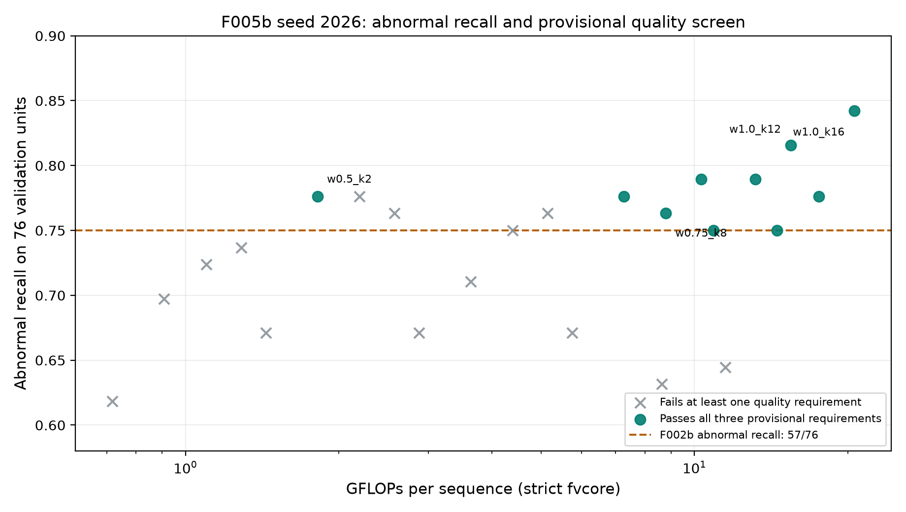

# F006a_2 — quality screening against frozen MobileNetV2

**Research question.** Which of the 24 width × frame-count configurations of
the deployable F005b seed-2026 TinyViT checkpoint meet provisional quality
requirements anchored to the frozen F002b MobileNetV2 reference? Among those,
which use the least model compute, and which remain feasible under the proposed
resource states? This is validation-only T012a analysis. The team agreed to
assess quality before optimizing compute; the numerical requirements and the
controller policy still need human approval. The F002b values are an **empirical
research reference, not clinical safety thresholds**.

## Evidence and reproduction

- F002b is the D025 frozen MobileNetV2 seed-2026 K16 checkpoint at
  [`checkpoints/f002b_mobilenetv2_seed2026.pt`](../../checkpoints/f002b_mobilenetv2_seed2026.pt),
  SHA-256 `5bad132633fd6188c0e449a75f73294612479bb1f0dc1820d8e6c459f7bdb823`.
  Its [record](../F002/README.md) gives duplicate-aware validation normal
  recall **168/178** and abnormal recall **57/76**. Under the frozen binary
  convention (class 0 normal, class 1 abnormal; TN/FP/FN/TP), these imply
  **TN 168, FP 10, FN 19, TP 57** on 254 units. Reconstructing metrics from
  these integer counts gives accuracy **225/254 = 0.8858267717**, macro-F1
  **0.8588753712**, abnormal recall **57/76 = 0.7500000000** and normal recall
  **168/178 = 0.9438202247**. The published 0.886/0.859/0.944 figures are
  rounded. Aggregate equality does not establish paired prediction agreement.
- Each TinyViT cell uses the selected epoch-5 duplicate-aware confusion counts
  and metrics in the canonical F005b
  [`run.json`](../../checkpoints/f005b_nested_seed2026/run.json), SHA-256
  `47710bc9f918576b5698d2f0eeaa3f6f1c7de127b483cd7c3e387f735e131bec`.
  The analysis verifies 178 normal and 76 abnormal units per cell and derives
  recalls, accuracy and macro-F1 from TN/FP/FN/TP. The canonical nested
  [`checkpoint.pt`](../../checkpoints/f005b_nested_seed2026/checkpoint.pt),
  SHA-256 `18d601e3ea04a1ba572ef99484c8681c5a3011dd7d3eb28309cb32906ff9e702`,
  supplies strict fvcore FLOPs, traced on its physically pruned widths through
  the existing [F006a analysis](../F006a/README.md).
  One multiply-add counts as one FLOP; this measures model work, not edge
  latency. Seed-2026 AUROC is available only to the three decimal places in
  F005's Table 3b and is reported at that precision.
- The 265 validation rows collapse to 254 known-dependency-aware evaluation
  units. The canonical F005b run available here contains aggregate counts;
  the original per-unit prediction artifacts are not in this checkout. This
  experiment therefore cannot compute paired intervals or claim statistical
  equivalence with MobileNetV2. No training, image inference,
  threshold fitting or held-out T006 test access occurs here.

Using the project's existing Python environment and F005/F006a dependencies:

```bash
python experiments/F006a_2/run_analysis.py
python experiments/F006a_2/run_analysis.py --check
python -m unittest tests.test_f006a_2
```

The script checks source/checkpoint hashes, reconstructs all 24 costs and
metrics, and writes deterministic
[`quality_screen.csv`](quality_screen.csv),
[`screening_summary.csv`](screening_summary.csv),
[`budget_feasibility.csv`](budget_feasibility.csv) and
[`sensitivity.csv`](sensitivity.csv). `--check` compares regenerated table
bytes; the normal run also regenerates the figure. The first table preserves
**every** configuration, including failures, with full quality profiles,
differences from F002b and explicit failure reasons. The
[quality-versus-work figure](figures/quality_vs_work.png)
adds abnormal recall and three-condition pass/fail to F006a's accuracy/F1
[Pareto figure](../F006a/figures/pareto.png).



## Provisional quality screen

A configuration passes only when **accuracy ≥ 225/254**, **macro-F1 ≥
½ × (336/365 + 114/143) ≈ 0.8588753712** and **abnormal
recall ≥ 57/76**, all at the frozen threshold 0.5. Comparisons use exact
fractions derived from counts, with inclusive equality. No rounded display
value decides a pass. Normal recall and rounded AUROC remain visible as
diagnostics, not additional gates. The limits are initial experimental
conditions, not an approved runtime rule.

| Requirement | Passing cells / 24 |
|---|---:|
| Accuracy | 12 |
| Macro-F1 | 10 |
| Abnormal recall | 14 |
| All three | **10** |

The ten survivors rank as follows by integer-derived model cost. The full CSV
also reports accuracy, normal recall, rounded AUROC and baseline differences
for each. The other 14 cells and each failed condition remain listed there.

| Rank | Width × K | GFLOPs | Macro-F1 | Abnormal recall |
|---:|---|---:|---:|---:|
| 1 | `w0.5_k2` | 1.816575299 | 0.869706 | 59/76 |
| 2 | `w0.5_k8` | 7.266300179 | 0.874008 | 59/76 |
| 3 | `w0.75_k8` | 8.782167315 | 0.877288 | 58/76 |
| 4 | `w1.0_k8` | 10.298034451 | 0.870767 | 60/76 |
| 5 | `w0.5_k12` | 10.899450099 | 0.858875 | 57/76 |
| 6 | `w0.75_k12` | 13.173250803 | 0.875047 | 60/76 |
| 7 | `w0.5_k16` | 14.532600019 | 0.863157 | 57/76 |
| 8 | `w1.0_k12` | 15.447051507 | 0.864384 | 62/76 |
| 9 | `w0.75_k16` | 17.564334291 | 0.874008 | 59/76 |
| 10 | `w1.0_k16` | 20.596068563 | 0.883089 | 64/76 |

In particular, `w0.5_k12` exactly matches
F002b's **aggregate** confusion counts and therefore passes equality at all
three boundaries; using rounded 0.886/0.859 as if exact would reject it.
Only four survivors are on F006a's two-dimensional macro-F1/FLOPs Pareto
frontier. Screening all 24 matters because a macro-F1-dominated point can
still have higher abnormal recall than its cheaper Pareto witness.

The lowest-cost survivor, **`w0.5_k2`**, uses **1.816575299 GFLOPs** and has
TN 168, FP 10, FN 17, TP 59: accuracy **227/254 = 0.8937007874**,
macro-F1 **0.8697064691**, abnormal recall **59/76 = 0.7763157895** and
normal recall **168/178 = 0.9438202247**. The next cheapest survivor,
`w0.5_k8`, costs 7.266300179 GFLOPs (the cheaper point uses 75% fewer FLOPs);
full-width K16 costs 20.596068563 GFLOPs (91.2% fewer). These are
compute comparisons, not a choice of operating point. Full-width K16 finds
64/76 abnormal units versus 59/76 for `w0.5_k2`, while `w0.5_k2` correctly
identifies 168/178 normal units versus 165/178 for full-width K16. An even
cheaper point cannot automatically replace the higher-recall alternative.

## Proposed resource-budget feasibility

For comparison with F006a, use its **proposed**, unapproved normalization
`B(b) = b × Cmax`, where `Cmax = 20,596,068,563` integer FLOPs (full-width
K16). A point is feasible if its integer FLOPs do not exceed the exact
fractional limit; rounded GFLOPs do not decide boundary cases. `b = 0.00`
means no inference. The table also keeps F006a Rule A (highest feasible
macro-F1 on its Pareto frontier) as a comparison; it is not the quality-first
selection rule.

| State `b` | Within budget / 24 | Quality **and** budget | Cheapest qualified | F006a Rule A |
|---:|---:|---:|---|---|
| 0.00 | 0 | 0 | **DEFER** | DEFER |
| 0.25 | 11 | 1 | `w0.5_k2` | `w0.5_k2` |
| 0.50 | 16 | 3 | `w0.5_k2` | `w0.75_k8` |
| 0.75 | 21 | 7 | `w0.5_k2` | `w0.75_k8` |
| 1.00 | 24 | 10 | `w0.5_k2` | `w1.0_k16` |

Thus every **active** state permits at least one configuration under the
initial limits; the zero state defers. The same cheap configuration can be
feasible at several budgets. In sensitivity scenarios where a budget has no
qualified configuration, the output says `DEFER` and never silently loosens
a quality requirement. Neither this table nor F006a Rule A is a final
controller mapping.

## Sensitivity and limits

[`sensitivity.csv`](sensitivity.csv) changes one requirement at a time:
accuracy by one, two or three correct validation units (1/254 each), abnormal
recall by one, two or three detected abnormal units (1/76 each), and macro-F1
by 0.005 or 0.010. The negative one-unit/−0.005 cases show slight relaxation;
positive cases show tightening. Each row records the resulting survivor set
and qualified count/cheapest option at every budget, including `DEFER`.
Relaxing any one requirement by the displayed small step still leaves ten
survivors because another requirement binds. Raising accuracy by one correct
unit leaves eight survivors; by three units it leaves five and makes `b =
0.25` infeasible. Raising macro-F1 by 0.005 leaves eight and by 0.010 leaves
seven, with all active budgets still feasible. Raising abnormal recall by one
detected unit leaves eight; by three units it leaves four and makes `b = 0.25`
and `b = 0.50` infeasible. These are **sensitivity checks, not tuned
thresholds**. The F005 three-seed
macro-F1 means and ranges in [Table 3](../F005/README.md) are secondary
robustness evidence only: the deployable point is seed 2026, and those
rounded three-seed summaries cannot certify every seed's three-metric pass.
For example, `w0.5_k2` has three-seed macro-F1 mean 0.862 and range
0.858–0.870, spanning the exact F002b macro-F1 reference. Small differences
within the reused validation set are fragile; checkpoint selection and this
screen both use validation. The proxy dataset and lack of per-unit paired
predictions prevent clinical, significance, or generalization claims.

## Human decisions before T012b

Charalampos and Salo must approve or revise (1) which empirical quality
requirements to use, including treatment of normal recall and uncertainty;
(2) the `Cmax` normalization, active-state budget semantics and DEFER rule;
and (3) the selection/tie-breaking rule among qualified feasible points,
considering the abnormal-recall trade-off rather than minimizing FLOPs alone.
T012b must then measure comparable chunked CPU runtime for the pruned points
before treating FLOPs as latency and implement/simulate the accepted rule.
T013's held-out evaluation requires a separately fixed protocol. This
experiment does not accept a controller or alter D025–D029.
