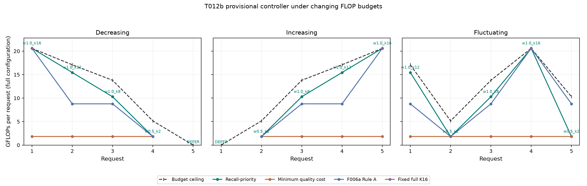

# F006b — provisional resource-aware controller (T012b)

**Question.** Can one deployable F005b shared-weight checkpoint serve a
deterministic, quality-screened width × frame-count policy as a continuous
model-work budget changes? F006b implements and simulates a **provisional**
validation-stage policy. Charalampos and Salo have not accepted its numerical
quality limits, budget normalization or selection rule as final T013 policy.
The frozen F002b MobileNetV2 remains the static reference; no model is trained
or changed here, and the T006 test partition is not used.

## Sources and policy

The 24 candidate profiles come from the complete
[F006a_2 screen](../F006a_2/quality_screen.csv): selected-epoch F005b
seed-2026 confusion counts for 254 duplicate-aware validation units, and
strict fvcore FLOPs recomputed from the canonical, tracked F005b checkpoint.
Ten of the 24 cells pass all three provisional quality requirements; the
controller still considers all 24 when deriving its feasible set.
The deployable bundle is
[`checkpoints/f005b_nested_seed2026/`](../../checkpoints/f005b_nested_seed2026/),
with checkpoint SHA-256
`18d601e3ea04a1ba572ef99484c8681c5a3011dd7d3eb28309cb32906ff9e702`.
Its selected-run `run.json` SHA-256 is
`47710bc9f918576b5698d2f0eeaa3f6f1c7de127b483cd7c3e387f735e131bec`;
the local CPU evidence records both bundle hashes.
The exact F002b MobileNetV2 empirical reference is accuracy **225/254**,
macro-F1 **½ × (336/365 + 114/143) ≈ 0.8588753712**, and abnormal recall
**57/76**. These are validation development thresholds, not clinical safety
requirements or paired evidence of superiority.

For every resource value `b ∈ [0,1]`, compute `B(b) = b × Cmax`, where
`Cmax = 20,596,068,563` integer FLOPs (full-width K16). At `b = 0`, defer
without inference. At `b > 0`, retain only cells that meet **all three** exact,
inclusive quality limits and whose integer FLOPs are at most `B(b)`. Among
those, maximize abnormal recall, then minimize FLOPs, then use a stable name
tie-breaker; defer if none remains. The implementation does not relax a limit
to force inference. A point's full model FLOPs are the budgeted work; any
incremental computation saved by reusing cached frames is reported separately.
CPU latency is supporting hardware evidence, not an alternate budget.

## Configurations and continuous budget

Reconstruction from **all 24** cells gives four distinct selected
configurations. No point count is imposed in the controller. Each selected
point is nondominated on the three axes of FLOPs, macro-F1 and abnormal
recall. `w1.0_k8` and `w1.0_k12` are dominated on F006a's original
macro-F1/FLOPs view, yet their higher abnormal recall gives them a role under
this different objective.

| Configuration | Exact FLOPs | First feasible `b` (`FLOPs/Cmax`) | Macro-F1 | Abnormal recall |
|---|---:|---:|---:|---:|
| `w0.5_k2` | 1,816,575,299 | 0.088200099618 | 0.869706 | 59/76 |
| `w1.0_k8` | 10,298,034,451 | 0.500000008230 | 0.870767 | 60/76 |
| `w1.0_k12` | 15,447,051,507 | 0.750000004115 | 0.864384 | 62/76 |
| `w1.0_k16` | 20,596,068,563 | 1.000000000000 | 0.883089 | 64/76 |

These ratios are displayed decimals; the exact integer/Fraction comparison
determines every boundary. In particular, full-width K8 and K12 are
**above** nominal `b = 0.50` and `b = 0.75`, respectively:
169.5 FLOPs for K8 and 84.75 FLOPs for K12. Rounded GFLOPs would hide these
boundary decisions.
The accepted D021 demonstration states remain part of the evaluation:

| D021 `b` | Provisional selection |
|---:|---|
| 0 | DEFER |
| 0.25 | `w0.5_k2` |
| 0.50 | `w0.5_k2` |
| 0.75 | `w1.0_k8` |
| 1.00 | `w1.0_k16` |

Continuous `b` support is a **proposed generalization**; it does not replace
D021's five states. The generated boundary and trace tables record the
requested intermediate values and exact threshold-neighbour checks.

| Checked `b` | Provisional selection |
|---:|---|
| 0, 0.05 | DEFER |
| 0.25, 0.50 | `w0.5_k2` |
| 0.5001, 0.67, 0.75 | `w1.0_k8` |
| 0.7501, 0.83, 0.99 | `w1.0_k12` |
| 1.00 | `w1.0_k16` |

The selected abnormal recall is nondecreasing as the budget rises (59, 60,
62, then 64 of 76 detected abnormal units). Macro-F1 need not be monotone;
in these source counts it falls from 0.870767 at `w1.0_k8` to 0.864384 at
`w1.0_k12` while abnormal recall rises. These point metrics do not by
themselves measure a mixed adaptive policy's macro-F1. The exact boundary and
monotonic-recall checks support **retaining continuous `b` for team review**
while keeping D021's five states as the required demonstration set.

## Runtime simulation and comparison

The implementation loads the hash-checked F005b bundle through its canonical
loader. F005's `NestedAnytimeClip` caches encoded features by both width and
frame within a clip: adding frames at one width can reuse its earlier work;
changing width recomputes features for that width. Clip boundaries clear the
cache. Direct inference and the cached result are checked for agreement.
Resource traces distinguish configuration work from incremental encoded-frame
work and record the selected point, prediction where images are available,
change/DEFER reasons, and measured latency only where a timed run exists.

Three deterministic five-request traces use decreasing
`1.00 → 0.83 → 0.67 → 0.25 → 0`, increasing
`0 → 0.25 → 0.67 → 0.83 → 1.00`, and fluctuating
`0.83 → 0.25 → 0.67 → 1.00 → 0.50` resources. They are fixed scenarios,
not levels chosen to force switching. Each scenario reuses one validation
clip across its five requests; the three clips come from distinct dependency
groups, and policies start separate caches. `configuration_flops` is the
full request cost; `incremental_modeled_flops` counts only newly encoded
frames plus the head when the same clip can reuse cached features. The
proposed rule selects, in order:

| Scenario | Selected configurations, including DEFER |
|---|---|
| Decreasing | `w1.0_k16 → w1.0_k12 → w1.0_k8 → w0.5_k2 → DEFER` |
| Increasing | `DEFER → w0.5_k2 → w1.0_k8 → w1.0_k12 → w1.0_k16` |
| Fluctuating | `w1.0_k12 → w0.5_k2 → w1.0_k8 → w1.0_k16 → w0.5_k2` |

The proposed rule is compared on the same resource traces with (1) the
cheapest quality-qualified point, (2) F006a Rule A, highest feasible
validation macro-F1, and (3) fixed full-width K16. A fixed rule defers when
its configuration exceeds the available budget. Trace-level FLOPs and
deferral counts are modeled from the selected configuration costs; a policy's
mixed-configuration macro-F1 would require its actual per-unit predictions,
not an average of configuration-level F1 values. The frozen MobileNetV2
reference is retained for T013, not retuned or evaluated on test here.

**Deterministic cost comparison.** Decreasing and increasing have the same
totals and change counts, although their choices occur in reverse order.
`selection_change` counts transitions including DEFER, while `model_switch`
counts active-to-active changes only. Full and incremental
columns are summed **modeled** GFLOPs over each five-request trace, with the
same clip reused within each policy/scenario; a new clip starts a fresh cache.

| Scenario | Policy | Inferences / 5 | Deferrals / 5 | Active switches | Full GFLOPs | Incremental GFLOPs |
|---|---|---:|---:|---:|---:|---:|
| Decreasing or increasing | Recall-priority | 4 | 1 | 3 | 48.158 | 22.413 |
| Decreasing or increasing | Minimum quality cost | 4 | 1 | 0 | 7.266 | 1.817 |
| Decreasing or increasing | F006a Rule A | 4 | 1 | 2 | 39.977 | 31.195 |
| Decreasing or increasing | Fixed full-width K16 | 1 | 4 | 0 | 20.596 | 20.596 |
| Fluctuating | Recall-priority | 5 | 0 | 4 | 49.974 | 22.413 |
| Fluctuating | Minimum quality cost | 5 | 0 | 0 | 9.083 | 1.817 |
| Fluctuating | F006a Rule A | 5 | 0 | 4 | 48.759 | 31.195 |
| Fluctuating | Fixed full-width K16 | 1 | 4 | 0 | 20.596 | 20.596 |

The per-request average is each five-request total divided by five;
[`comparison.csv`](comparison.csv) records the exact full and incremental
means alongside the totals.

All 12 scenario × policy rows have **zero budget violations**. The proposed
policy makes four selection changes including DEFER in each scenario (three
active switches in decreasing/increasing; four in fluctuating). The cheap
policy spends less work but stays at 59/76 abnormal recall; the proposed
policy can reach 60/76, 62/76 and 64/76 as budgets permit. F006a Rule A
prioritizes macro-F1 instead, so it chooses `w0.75_k8` at some middle budgets
where the recall-priority rule chooses higher-recall full-width K8 or K12.
None of these scenario totals is a measured adaptive macro-F1.

## Reproduction and evidence

Using the project's existing Python environment and F005/F006a dependencies:

```bash
python experiments/F006b/simulate.py
python experiments/F006b/simulate.py --check
python experiments/F006b/simulate.py --inference
python experiments/F006b/benchmark_cpu.py --device cpu --input-mode validation --threads 4 --chunk-size 4 --warmup 5 --requests 50 --repeats 5 --output artifacts/F006b/cpu_benchmark_repeat.json
python -m unittest tests.test_f006b_controller tests.test_f006b_runtime tests.test_f006b_benchmark
```

The deterministic simulation writes the complete
[`resource_trace.csv`](resource_trace.csv),
[`comparison.csv`](comparison.csv),
[`budget_sweep.csv`](budget_sweep.csv),
[`budget_boundaries.csv`](budget_boundaries.csv), and
[`simulation_summary.json`](simulation_summary.json). `--check` regenerates
and byte-compares these tables. The
[response figure](figures/controller_response.png) shows full configuration
FLOPs under each changing budget and policy. `--inference` additionally
writes the ignored local raw file
`artifacts/F006b/validation_inference_trace.csv` by serving one clip from
each of three distinct validation dependency groups; those observations are
separate from the tracked deterministic policy tables. The local observed
trace has SHA-256
`35c6105b5a0933ea9649bdd399191cbf582e433995c9c573db48518eb59aaf80`.
The selected clips are the first rows of three distinct groups in the frozen
T006 validation manifest. Each policy serves the same five resource requests
per clip. Probability, class and incidental local call latency appear only
when the image-serving command actually runs; the deterministic trace leaves
those fields blank. Rerunning `--inference` overwrites this separate observed
trace; local per-call times can vary and are not part of the byte check.



The saved CPU job used the same flags with `--output
artifacts/F006b/cpu_benchmark_local.json`; the command above uses a new,
ignored destination because the benchmark refuses to overwrite timing
evidence. The local raw JSON has SHA-256
`2eb24db9233fe17d0fa91b39543affe6927222e2b41da2c2d1eb22d119bce0fa`.
It times all selected points together on one CPU, with preloaded validation tensors,
chunk size four, five warm-up requests per configuration, 50 timed requests and five
round-robin repeats by default. It records processor, threads, request IDs,
direct and chunked medians/throughput, switching overhead and their raw
repeats; it checks direct/chunked logits before timing. This is **model-only
local Ryzen CPU evidence**, separate from earlier DAS-5 runs and from edge-device
measurements. FLOPs remain the controller's resource constraint.

**Actual validation serving.** The saved image-serving trace has 60
scenario × policy × request rows: 42 non-DEFER predictions (13 each for the
proposed, minimum-cost and Rule A policies; three for fixed K16) and 18
deferrals. Every non-DEFER request was checked against direct inference;
the largest cached/direct absolute logit difference is **0.0** in the saved
trace. All 42 predictions are class 0 on these three deterministically
chosen clips. Repeated requests on three clips cannot estimate adaptive
accuracy or macro-F1. The trace's local per-call times include cache hits
(some around 0.1 ms) and are diagnostic, not the comparable full-request
CPU benchmark below.

**Local comparable CPU timing.** The full job ran on Windows 11, AMD Ryzen AI
9 HX 370, PyTorch CPU with four threads. All four points used the same first
50 frozen validation timing IDs, five warm-up requests per configuration and five round-robin
repeats. Frames were preloaded and normalized; timing covered model
selection/encoding/pooling/head, not JPEG decoding or data transfer. The
maximum direct-versus-chunked logit difference was **0.0** at every point.

| Selected point | Direct median ms | Chunk-4 median ms | Chunk-4 sequences/s | Switching delta ms |
|---|---:|---:|---:|---:|
| `w0.5_k2` | 31.66 | 31.66 | 31.37 | −0.15 |
| `w1.0_k8` | 174.51 | 168.62 | 5.90 | −0.85 |
| `w1.0_k12` | 258.72 | 249.80 | 3.98 | +1.04 |
| `w1.0_k16` | 349.91 | 333.01 | 2.99 | +2.74 |

The switching delta is median per-repeat interleaved minus grouped latency
on the **same** point × input multiset: 146 configuration changes in the
interleaved order versus three in the grouped order. Each switching pass warms
five requests per point before timing. The small deltas change
sign and are within the local repeat spread, so this job does not establish
a material switching penalty. Chunking saves some time at K8–K16 on this
host; K2 is effectively unchanged. Absolute times are local Ryzen results
and are not directly comparable with the earlier DAS-5 Xeon jobs or evidence
of a deployed edge device.

The source confusion matrices summarize a validation-selected F005b epoch and
do not include all paired per-unit predictions for a MobileNetV2 comparison.
Three-seed F005 summaries are robustness context, not inputs to this frozen
seed-2026 controller. The same validation units informed checkpoint and
policy development; apparent gains may be optimistic. FLOPs exclude image
decoding and do not measure energy, battery, thermal load or clinical safety.

## Team decisions before T013

Charalampos and Salo must approve or revise the three empirical quality
requirements, `Cmax` normalization and continuous-budget semantics, the
recall-first selection/tie-break rule and final operating points. They must
also choose the final static-versus-adaptive evaluation protocol, including
how validation-driven selection, duplicate-aware units and hardware timing
are reported, **before** any held-out T006 test inference. This experiment
records a reproducible proposed policy, not a new accepted decision.
